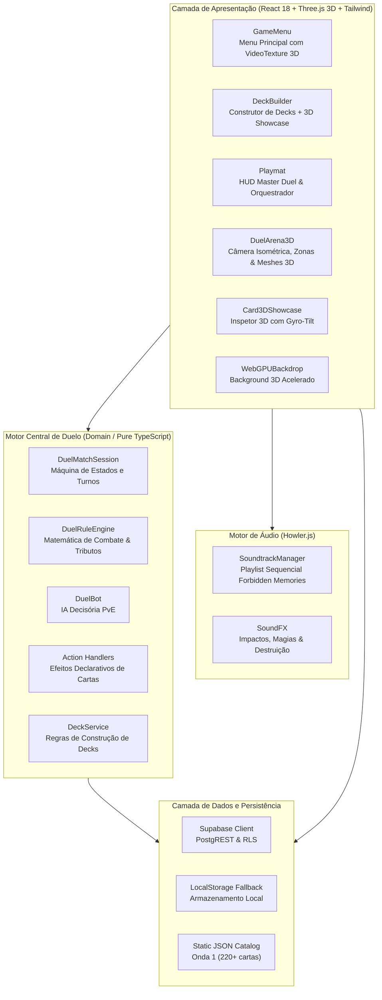
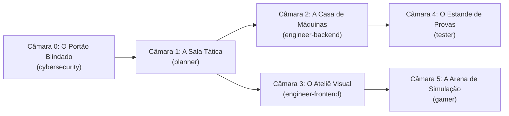
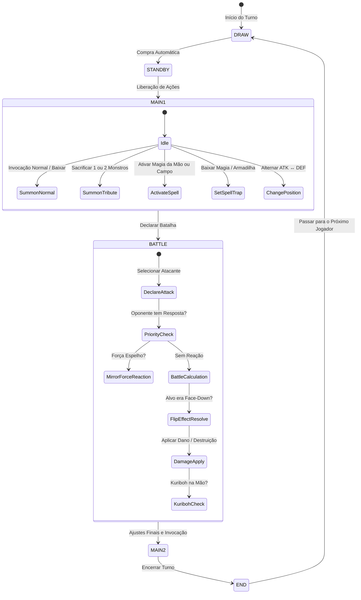
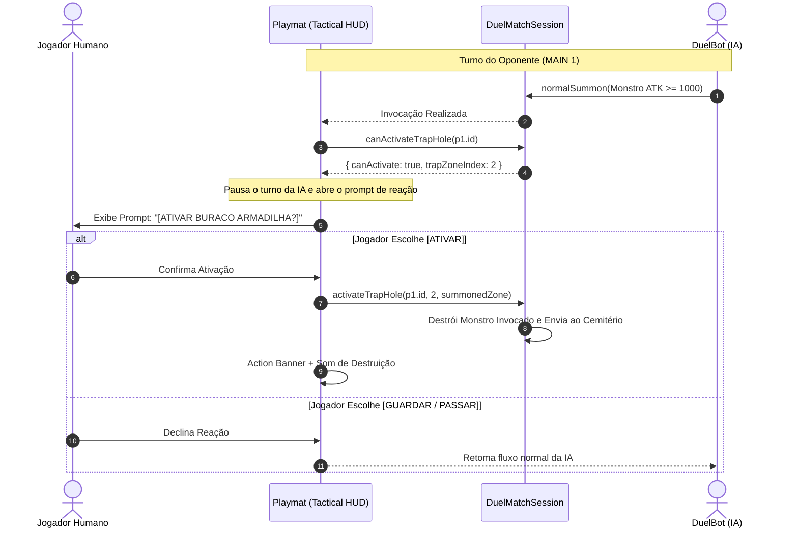
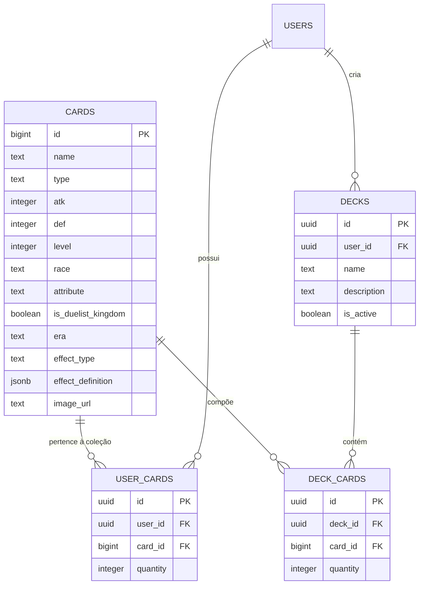

# 🎴 Yu-Gi-Oh! Duelist Kingdom Engine (Retro Simulator)

[](https://www.typescriptlang.org/)
[](https://react.dev/)
[-black.svg?logo=three.js)](https://threejs.org/)
[](https://vitejs.dev/)
[-729B1B.svg?logo=vitest)](https://vitest.dev/)
[](https://tailwindcss.com/)
[](https://supabase.com/)
[](https://conventionalcommits.org)

Simulador tático completo de duelos retrô inspirado no arco clássico do **Reino dos Duelistas (*Yu-Gi-Oh! Duelist Kingdom*)** e no aclamado jogo **Yu-Gi-Oh! Forbidden Memories (PS1)**. Desenvolvido com arquitetura modular de alta performance em **TypeScript**, **React 18**, renderização 3D em tempo real com **Three.js (WebGPU / WebGL2)**, **Supabase (PostgreSQL + RLS)**, áudio adaptativo com **Howler.js** e suíte contínua de testes unitários com **Vitest** (**181/181 testes aprovados** no padrão AAA).

---

## 📑 Tabela de Conteúdos
1. [Visão Geral do Sistema](#-visão-geral-do-sistema)
2. [Arquitetura Geral do Jogo](#-arquitetura-geral-do-jogo)
   - [Diagrama de Arquitetura em Camadas](#diagrama-de-arquitetura-em-camadas)
   - [O Palácio da Memória (Memory Palace Hexagonal)](#o-palácio-da-memória-memory-palace-hexagonal)
   - [Fluxo da Máquina de Estados de Duelo](#fluxo-da-máquina-de-estados-de-duelo)
   - [Janela de Prioridade e Observer de Armadilhas](#janela-de-prioridade-e-observer-de-armadilhas)
3. [Motor Gráfico 3D (Three.js + WebGPU)](#-motor-gráfico-3d-threejs--webgpu)
   - [Pipeline Híbrido WebGPU / WebGL2](#pipeline-híbrido-webgpu--webgl2)
   - [Arena 3D Imersiva & Mãos em Linha Reta](#arena-3d-imersiva--mãos-em-linha-reta)
   - [Inspetor de Cartas 3D com Gyro-Tilt](#inspetor-de-cartas-3d-com-gyro-tilt)
   - [Gerador Procedural de Texturas e Verso em Canvas](#gerador-procedural-de-texturas-e-verso-em-canvas)
4. [Design System & HUD Tático (Dark Stone & Aged Gold)](#-design-system--hud-tático-dark-stone--aged-gold)
5. [Conceitos de Engenharia de Software Implementados](#-conceitos-de-engenharia-de-software-implementados)
   - [Design Patterns (Padrões de Projeto)](#design-patterns-padrões-de-projeto)
   - [Princípios SOLID](#princípios-solid)
   - [Algoritmos e Estruturas de Dados](#algoritmos-e-estruturas-de-dados)
   - [Segurança e Resiliência (Security by Design)](#segurança-e-resiliência-security-by-design)
   - [Engenharia de Áudio com Howler.js](#engenharia-de-áudio-com-howlerjs)
6. [Estrutura de Pastas e Módulos](#-estrutura-de-pastas-e-módulos)
7. [Modelagem de Dados e Banco de Dados (Supabase)](#-modelagem-de-dados-e-banco-de-dados-supabase)
8. [Catálogo da Onda 1 e Starter Decks](#-catálogo-da-onda-1-e-starter-decks)
9. [Como Executar o Projeto](#-como-executar-o-projeto)
10. [Suíte de Testes Automatizados (181/181 Aprovados)](#-suíte-de-testes-automatizados-181181-aprovados)

---

## 🌟 Visão Geral do Sistema

O projeto recria com fidelidade a estética e as regras clássicas de Yu-Gi-Oh!, combinando tecnologia moderna de navegação web com a nostalgia dos anos 2000:
- **Arena de Duelo 3D Exclusiva (`DuelArena3D`):** Renderização tridimensional completa de campo 5x4, cartas com malhas volumétricas (`BoxGeometry`), física de investida (*Lunge* 3D), desintegração por partículas (*ParticleVFX*), elevação no hover e sincronização imediata mão-para-campo.
- **Hardware Acceleration Guard (`App.tsx`):** Diagnóstico preliminar de aceleração gráfica por hardware (WebGPU / WebGL2 nativa) com bloqueio gracioso e instruções de ativação para Chrome, Edge e Firefox.
- **HUD Tático Estilo Master Duel:** Placas angulares de LP nos cantos com apelidos de jogador, painel lateral recolhível de inspeção com arte 3D e lore integral, controle de turno e fases à direita (`MAIN 1`, `FASE DE BATALHA`, `ENCERRAR TURNO`), e pílulas de ATK/DEF nos monstros do campo exibidas sob demanda via hover tático suave.
- **Design System Sóbrio (*Dark Stone & Aged Gold*):** Erradicação completa de emojis infantis e cores neon em favor de paleta temática de ferro, pedra escura e ouro envelhecido, com badges técnicos em CSS.
- **IA de Duelo PvE (`DuelBot`):** Tomada de decisão autônoma com invocação normal, tributos de nível 5-6 (1 sacrifício) e 7+ (2 sacrifícios), leitura de campo para ativação de magias (Pote da Ganância, Buraco Negro, Fissura) e reação seletiva com armadilhas (Buraco Armadilha, Força Espelho).
- **Construtor Visual de Decks (`DeckBuilder`):** Catálogo compilado com mais de 220 cartas homologadas da Onda 1, filtros por tipo/nível, limite oficial de 3 cópias por carta, 3 decks por duelista e persistência híbrida (Supabase + localStorage).
- **Áudio Adaptativo Clássico:** Trilhas sonoras originais de *Yu-Gi-Oh! Forbidden Memories* com alternância contínua entre *Egypt in Ruins* e *Password*, fanfarras dedicadas de vitória e derrota, e sonoplastia para cada ação mecânica.

---

## 🏛️ Arquitetura Geral do Jogo

O sistema segue os princípios da **Arquitetura Limpa / Hexagonal (Ports & Adapters)**, mantendo o domínio de regras (`src/duel/`) completamente isolado da apresentação React/Three.js e dos mecanismos de banco de dados.

### Diagrama de Arquitetura em Camadas



---

### O Palácio da Memória (Memory Palace Hexagonal)

A governança do projeto é estruturada segundo o **Memory Palace** (`docs/memory-palace/PALACE.md`), com câmaras de responsabilidade estrita para cada agente e desenvolvedor:



- **Câmara 0 (`cybersecurity`):** Row Level Security (RLS) no Supabase, sanitização de catálogos, auditoria OWASP Top 10 e expurgo de segredos do histórico do Git.
- **Câmara 1 (`planner`):** Arquitetura geral, decomposição de épicos, alinhamento técnico e prompts orquestradores.
- **Câmara 2 (`engineer-backend`):** Domínio de combate puro (`DuelMatchSession`, `DuelRuleEngine`, `action-handlers.ts`, `DeckService`).
- **Câmara 3 (`engineer-frontend`):** Interface gamer sóbria (*Dark Stone & Aged Gold*), HUD ergonômico e componentes React.
- **Câmara 4 (`tester`):** Cultura AAA (*Arrange, Act, Assert*) com política estrita de zero regressão em 181 testes automatizados.
- **Câmara 5 (`gamer`):** Arena 3D Three.js/WebGPU, cálculos de lunge, animações de câmera, loop de áudio Howler.js e IA de duelo.

---

### Fluxo da Máquina de Estados de Duelo

O turno segue rigorosamente o fluxograma oficial de Yu-Gi-Oh!, controlado por `DuelMatchSession`:



---

### Janela de Prioridade e Observer de Armadilhas

O simulador implementa **Janelas de Prioridade Reativas (*Priority Windows*)**, pausando o fluxo assíncrono para dar direito de resposta tática ao duelista:



---

## 🎮 Motor Gráfico 3D (Three.js + WebGPU)

O projeto opera exclusivamente com **renderização 3D em tempo real** através dos módulos localizados em `client/src/components/duel3d/`:

### Pipeline Híbrido WebGPU / WebGL2
- **`webgpuCore.ts`:** Provedor assíncrono do renderer. Investiga o adaptador de hardware do navegador via `navigator.gpu.requestAdapter()`. Caso a WebGPU esteja disponível, instancia `WebGPURenderer` do `three/webgpu`; caso contrário, executa *fallback* transparente e imediato para o `WebGLRenderer` (WebGL2 nativo).
- **Hardware Guard:** `App.tsx` valida previamente o suporte de hardware e exibe tela de instrução passo a passo caso a aceleração 3D esteja desativada no navegador.

### Arena 3D Imersiva & Mãos em Linha Reta
- **`DuelArena3D.tsx`:** Campo de batalha 3D em tela cheia (100vw x 100vh) com câmera isométrica inclinada (`x=0, y=16.2, z=9.8`).
- **Mão em Linha Reta (*Zero Fan*):** As cartas da mão do jogador são distribuídas horizontalmente em linha reta abaixo da mesa (`Y = 0.55, Z = 7.15, RotZ = 0`), garantindo visibilidade desobstruída do playmat.
- **Pílulas de Atributos sob Hover:** Os badges com `[Nome]` e `[ATK] / [DEF]` dos monstros no campo permanecem ocultos em repouso e surgem suavemente apenas sob a passagem do cursor do mouse, eliminando poluição visual.

### Inspetor de Cartas 3D com Gyro-Tilt
- **`Card3DShowcase.tsx`:** Inspetor holográfico lateral. A carta inspecionada é renderizada como um mesh tridimensional que reage organicamente ao movimento do cursor do mouse com inclinação giroscópica (*gyro-tilt*), iluminação dourada e reflexão unlit com `MeshBasicMaterial` para cores autênticas e zero ofuscamento (*glare*).
- **Modo Verso 3D (`isBack={true}`):** Quando nenhuma carta está selecionada ou inspeciona-se uma carta oculta do oponente, o componente renderiza o verso canônico tridimensional em vez de tags 2D quebradas.

### Gerador Procedural de Texturas e Verso em Canvas
- **`cardTextureGenerator.ts`:** Motor procedural em Canvas 2D que renderiza síncronamente molduras clássicas (Monstro Normal, Efeito, Magia, Armadilha) e o verso oficial de Yu-Gi-Oh! (`drawProceduralCardBack`), incluindo bordas marrom-avermelhadas, câmara escura, vórtice cósmico âmbar e selo holográfico dourado no canto inferior, sem dependência de requisições de rede externas.

---

## 🎨 Design System & HUD Tático (Dark Stone & Aged Gold)

Toda a interface da aplicação foi rigorosamente unificada sob a estética **Dark Stone & Aged Gold** (inspirada em *Yu-Gi-Oh! Master Duel* e no Egito Antigo):

- **Paleta de Cores Soberba:**
  - Fundo & Painéis: Preto Obsidiana `#0c0a09`, Pedra Escura `#141210`, `#1c1917`.
  - Bordas e Acentos: Ouro Envelhecido `#78350f`, `#b45309`, Âmbar Místico `#f59e0b`, `#fbbf24`.
  - Textos: Pergaminho / Pedra Clara `#e7e5e4`, `#d6d3d1`.
- **Insígnias e Badges Técnicas em CSS:**
  - Substituição de emojis por tags técnicas: `[SOLO]`, `[DECK]`, `[CFG]`, `[RENDER-SE]`, `[INFO]`, `[LOG]`, `[ATK]`, `[DEF]`, `[OCULTA]`, `[GRIMOIRE TÁTICO]`.
- **Interface Limpa:**
  - Remoção de todos os badges de depuração gráfica visíveis ao usuário final (como badges flutuantes de WebGPU), mantendo o ecossistema gráfico 100% integrado nos bastidores.

---

## 🧠 Conceitos de Engenharia de Software Implementados

### Design Patterns (Padrões de Projeto)

#### 1. Strategy Pattern & Command Pattern (`action-handlers.ts`)
Efeitos de cartas são despachados dinamicamente através de manipuladores declarativos unificados sob a assinatura `ActionExecutionContext`:
```typescript
export interface ActionExecutionContext {
  cardInstance: CardInstance;
  player: PlayerDuelState;
  opponent: PlayerDuelState;
  targetUids?: string[];
  randomIntFn?: (maxExclusive: number) => number;
  logFn?: (message: string) => void;
  session?: any;
}
```
Manipuladores implementados:
- `BOOST_ATK`: Avaliação dinâmica contextual (Buster Blader ganhando +500 ATK por Dragão no campo/cemitério do oponente).
- `DESTROY_MONSTER`: Destruição direcionada (Man-Eater Bug).
- `RETURN_TO_HAND`: Devolução seletiva de até 2 monstros (Penguin Soldier).
- `WABOKU_SHIELD`: Proteção integral contra dano e destruição de batalha no turno.
- `TRIGGER_MIRROR_FORCE`: Destruição em massa de todos os monstros em posição de ataque do oponente.
- `COIN_TOSS_CLEAR`: Roleta 50/50 com autodestruição e burn damage (*Time Wizard*).
- `GAIN_LP` & `INFLICT_DAMAGE`: Magias de cura (*Dian Keto*) e dano direto (*Hinotama, Ookazi*).
- `DESTROY_SPELL_TRAP`: Destruição de cartas na zona de Magia/Armadilha (*De-Spell*).

#### 2. Observer Pattern / Priority Prompts (`Playmat.tsx`)
A mesa escuta eventos do motor de duelo e suspende a execução assíncrona para permitir reações voluntárias do jogador (Buraco Armadilha na invocação, Força Espelho no ataque, Waboku livre no turno adversário).

#### 3. State Pattern (`duel-match-session.ts`)
Transição estrita de fases (`DRAW` $\rightarrow$ `STANDBY` $\rightarrow$ `MAIN 1` $\rightarrow$ `BATTLE` $\rightarrow$ `MAIN 2` $\rightarrow$ `END`) garantindo que ataques só ocorram na fase de batalha e tributos na fase principal.

#### 4. Repository & Service Pattern (`deck-service.ts` e `deckStorage.ts`)
Desacoplamento completo entre a regra de montagem de decks e a persistência (Supabase com fallback transparente para localStorage).

---

### Princípios SOLID

| Princípio | Aplicação no Projeto |
| :--- | :--- |
| **S - Single Responsibility** | Separação estrita entre o cálculo matemático de batalha (`DuelRuleEngine`), o ciclo de vida da sessão (`DuelMatchSession`), a IA de decisão (`DuelBot`), os manipuladores de efeitos (`action-handlers.ts`), o pipeline 3D (`DuelArena3D`, `webgpuCore`) e a persistência (`DeckService`). |
| **O - Open/Closed** | Novas cartas são incorporadas via definições JSON declarativas (`effectDefinition`), sem necessidade de modificar os motores de combate existentes. |
| **L - Liskov Substitution** | Todos os `ActionHandler` respeitam contratos uniformes de entrada e saída. |
| **I - Interface Segregation** | Contratos enxutos e estritos (`CardData`, `CardInstance`, `PlayerDuelState`, `BattleResult`, `DeckModel`), evitando acoplamento excessivo. |
| **D - Dependency Inversion** | O `DeckService` aceita interfaces abstratas de persistência (`StorageLike`) e clientes injetáveis do Supabase. |

---

### Algoritmos e Estruturas de Dados

1. **Embaralhamento Criptográfico Fisher-Yates:** Utiliza `crypto.getRandomValues()` para geração de números pseudoaleatórios criptograficamente seguros em 3 passadas de lavagem/corte (*riffle shuffle*).
2. **Vetores Cartesianos de Lunge 3D:** Interpolação linear (*lerp*) e vetores direcionais $(\Delta x, \Delta z)$ para animar a investida física do monstro atacante em direção ao alvo na arena 3D.
3. **Raycasting e Hitbox Tridimensional:** Interseção precisa de ponteiro com malhas 3D para seleção de zonas e cartas, protegido contra *stale closures* e *flicker*.

---

### Segurança e Resiliência (Security by Design)

- **Higienização Completa do Git:** O histórico do repositório foi purgado e higienizado com `git filter-branch` e coleta de lixo agressiva, eliminando quaisquer dados ou chaves sensíveis antigas.
- **Blindagem do `.gitignore`:** Proteção abrangente cobrindo `.env`, `.env.*` (preservando apenas o `.env.example`), `.mcp.json*`, certificados (`*.pem`, `*.cert`) e chaves privadas (`*.key`).
- **Row Level Security (RLS) no PostgreSQL:** Tabelas `decks`, `deck_cards` e `user_cards` protegidas no nível de linha no Supabase (`auth.uid() = user_id`).
- **Validação de Entrada:** Tratamento defensivo de payloads e IDs em todos os serviços.

---

### Engenharia de Áudio com Howler.js

O [`SoundtrackManager.ts`](file:///mnt/Dados/Projetos/run/client/src/utils/SoundtrackManager.ts) gerencia o ecossistema sonoro do simulador:
1. **Menu Principal:** Tema clássico em loop contínuo.
2. **Fila Sequencial da Partida:** Rotação contínua e fluida entre *Egypt in Ruins* e *Password* ao disparar o evento `onend`, eliminando lacunas de silêncio ou sobreposições.
3. **Cortes de Estado Idempotentes:** Interrupção imediata da música de duelo na ocorrência de vitória (*You Win*) ou derrota (*You Lose*).

---

## 📂 Estrutura de Pastas e Módulos

```text
.
├── client/                               # Aplicação Frontend (React 18 + Three.js 3D + Vite)
│   ├── public/                           # Assets estáticos servidos pelo Vite
│   │   ├── audio/                        # Trilhas clássicas de Forbidden Memories (MP3)
│   │   ├── video/                        # Background cinematográfico do menu (banner.mp4)
│   │   └── card-back.jpg                 # Verso oficial de Yu-Gi-Oh!
│   ├── src/
│   │   ├── components/                   # Componentes React de UI / Apresentação
│   │   │   ├── duel3d/                   # Módulos do Ecossistema 3D (Three.js / WebGPU)
│   │   │   │   ├── DuelArena3D.tsx       # Arena 3D isométrica Master Duel com câmera e zonas
│   │   │   │   ├── Card3DShowcase.tsx    # Inspetor holográfico 3D com gyro-tilt
│   │   │   │   ├── WebGPUBackdrop.tsx    # Background 3D acelerado com VideoTexture
│   │   │   │   ├── webgpuCore.ts         # Provedor híbrido WebGPU / WebGL2 e Hardware Guard
│   │   │   │   └── cardTextureGenerator.ts # Gerador procedural em canvas de molduras e verso
│   │   │   ├── Playmat.tsx               # Orquestrador do Duelo & HUD Tático Master Duel
│   │   │   ├── DeckBuilder.tsx           # Construtor Visual de Decks da Onda 1
│   │   │   ├── GameMenu.tsx              # Menu Principal Dark Stone & Aged Gold
│   │   │   ├── SettingsModal.tsx         # Configurações de som e idioma
│   │   │   └── AuthModal.tsx             # Modal de Autenticação Supabase
│   │   ├── data/
│   │   │   └── duelist-kingdom-catalog.json # Catálogo compilado da Onda 1 (220+ cartas)
│   │   ├── utils/                        # Utilitários de Frontend e Áudio
│   │   │   ├── SoundtrackManager.ts      # Orquestrador de trilhas sonoras Howler.js
│   │   │   ├── soundFX.ts                # Efeitos sonoros táticos (ataque, magia, destruição)
│   │   │   ├── deckStorage.ts            # Gerenciamento local e sincronização de decks
│   │   │   └── settings.ts               # Persistência de preferências de usuário
│   │   ├── App.tsx                       # Roteador raiz e Hardware Acceleration Guard
│   │   └── main.tsx                      # Ponto de entrada React DOM
│   └── index.html                        # HTML raiz com estilos globais e animações CSS
├── src/                                  # Motor Central de Regras (Domain Puro - TypeScript)
│   └── duel/
│       ├── effects/
│       │   └── action-handlers.ts        # Strategy Pattern: Handlers de efeitos de cartas
│       ├── card-catalog-service.ts       # Serviço de consulta e enriquecimento de cartas
│       ├── deck-service.ts               # Regras de negócio de montagem e validação de decks
│       ├── duel-bot.ts                   # Inteligência Artificial PvE
│       ├── duel-match-session.ts         # Orquestrador de partida e máquina de estados
│       ├── duel-rule-engine.ts           # Motor matemático puro de combate e tributos
│       ├── duel-types.ts                 # Tipagens e contratos TypeScript do domínio
│       └── starter-decks.ts              # Decks clássicos pré-montados de Yugi e Kaiba
├── supabase/                             # Infraestrutura de Banco de Dados
│   └── migrations/                       # Migrações SQL versionadas
│       ├── 20261017000000_initial_schema.sql         # Schema base (cards, decks, user_cards)
│       ├── 20261017010000_add_duelist_kingdom_era.sql # Marcação da era Reino dos Duelistas
│       └── 20261017020000_add_card_effects.sql       # Colunas effect_type e effect_definition JSONB
├── scripts/                              # Scripts operacionais e de sincronização
│   ├── export-wave1-catalog.ts           # Compilador estático do catálogo da Onda 1
│   ├── sync-cards.ts                     # Sincronizador de cartas com YGOPRODeck
│   └── tag_duelist_kingdom.py            # Marcação oficial dos sets clássicos no banco
├── docs/                                 # Documentação Técnica e Governança
│   └── memory-palace/
│       └── PALACE.md                     # Mapa cognitivo compartilhado (Memory Palace)
├── package.json                          # Metadados e dependências do projeto
├── tsconfig.json                         # Configuração estrita do compilador TypeScript
├── vite.config.ts                        # Configuração de build e aliases do Vite
└── vitest.config.ts                      # Configuração da suíte de testes Vitest
```

---

## 🗄️ Modelagem de Dados e Banco de Dados (Supabase)

O esquema relacional garante integridade referencial e performance através de índices especializados:



---

## 🃏 Catálogo da Onda 1 e Starter Decks

O jogo possui catálogo homologado da **Onda 1 do Reino dos Duelistas**, compilado em `client/src/data/duelist-kingdom-catalog.json`:
- **Mais de 220 Cartas Únicas:** Monstros clássicos (Dragão Branco de Olhos Azuis, Mago Negro, Crânio Convocado, Dragão Negro de Olhos Vermelhos, Rei de Duas Cabeças Rex, Guardião Celta), Magias de Controle de Campo e Armadilhas Clássicas.
- **Traduções Oficiais em Português:** Campos `namePt` e `descriptionPt` padronizados segundo a nomenclatura oficial consagrada no Brasil.
- **Metadados Completos:** Atributo, Raça (Dragon, Spellcaster, Fiend, Warrior, etc.), Nível (1 a 8), ATK e DEF.
- **Decks Clássicos Pré-Montados:** Decks de 40 cartas de **Yugi Muto** e **Seto Kaiba** prontos para jogar.

---

## 🚀 Como Executar o Projeto

### Pré-requisitos
- **Node.js:** Versão 18.0 ou superior.
- **NPM:** Gerenciador de pacotes padrão.

### Instalação
Clone o repositório e instale as dependências:
```bash
git clone <url-do-repositorio>
cd run
npm install
```

### Executar em Modo de Desenvolvimento
Inicia a aplicação localmente com hot-reload no Vite:
```bash
npm run dev
```
Abra [http://localhost:3000](http://localhost:3000) no seu navegador com suporte a aceleração gráfica por hardware ativa.

### Compilar para Produção
Gera os arquivos otimizados em `dist/`:
```bash
npm run build
```

---

## 🧪 Suíte de Testes Automatizados (181/181 Aprovados)

O projeto mantém uma política inegociável de **Zero Regressão**, com todos os testes escritos no padrão **AAA (Arrange, Act, Assert)**.

Para executar todas as suítes de teste via **Vitest**:
```bash
npm test
```

### Cobertura das 10 Suítes de Teste:
1. `src/duel/duel-rule-engine.test.ts` (12 testes): Matemática pura de batalha, posições de combate, cálculo de dano refletido e regras de sacrifício (Nível 5-6 $\rightarrow$ 1 sacrifício, Nível 7+ $\rightarrow$ 2 sacrifícios).
2. `src/duel/duel-match-session.test.ts` (86 testes): Fases do duelo, resolução prioritária de efeitos FLIP (Man-Eater Bug, Penguin Soldier), efeitos contínuos por raça (Buster Blader), ativação de magias (Raigeki, Dark Hole, Pote da Ganância, Dian Keto, Hinotama, De-Spell) e armadilhas (Mirror Force, Waboku, Trap Hole).
3. `src/duel/deck-service.test.ts` (8 testes): Regras de construção de deck (limite de 3 cópias, 3 decks personalizados, alternância atômica de deck ativo, validação de 40 monstros da Onda 1).
4. `client/src/utils/deckStorage.test.ts` (12 testes): Sanitização de catálogo, integridade de IDs, ausência de duplicatas e persistência local.
5. `client/src/utils/SoundtrackManager.test.ts` (7 testes): Inicialização de áudio, fila contínua de reprodução e tratamento de mute/volume.
6. `client/src/utils/settings.test.ts` (6 testes): Persistência de preferências de idioma e som no `localStorage`.
7. `client/src/components/duel3d/DuelArena3D.test.ts` (15 testes): 20 zonas espaciais 3D, distribuição da mão em linha reta (*zero fan*), coordenadas estáveis de hitbox, despacho de cliques e investidas de combate.
8. `client/src/components/duel3d/cardTextureGenerator.test.ts` (10 testes): Paletas clássicas por tipo de carta, resolução de URLs anti-CORS `/api/card-image/`, geração procedural de molduras e verso canônico em canvas 2D.
9. `client/src/components/duel3d/webgpuCore.test.ts` (10 testes): Sondagem de adaptadores WebGPU, fallback seguro para WebGL2 nativo e descarte de recursos de cena (*disposeSceneResources*).
10. `client/src/components/FrontendWebGPU.test.ts` (15 testes): Integração dos componentes React 3D (`App`, `AuthModal`, `GameMenu`, `DeckBuilder`, `Playmat`, `DuelArena3D`, `Card3DShowcase`, `WebGPUBackdrop`), suporte ao verso 3D e sincronização do fluxo mão-para-campo.

---

## 📜 Licença e Créditos

Este projeto foi construído para fins educacionais, de pesquisa em arquitetura de software e tributo aos fãs de Yu-Gi-Oh!.
- **Artes e Marcas de Cartas:** © Studio Dice / SHUEISHA, TV TOKYO, KONAMI.
- **Trilhas Sonoras Clássicas:** Yu-Gi-Oh! Forbidden Memories (Konami, 1999).
