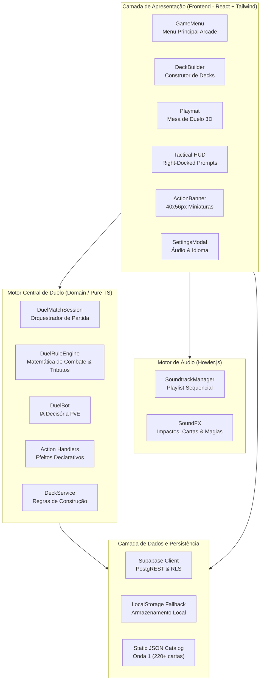
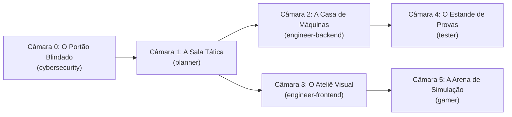
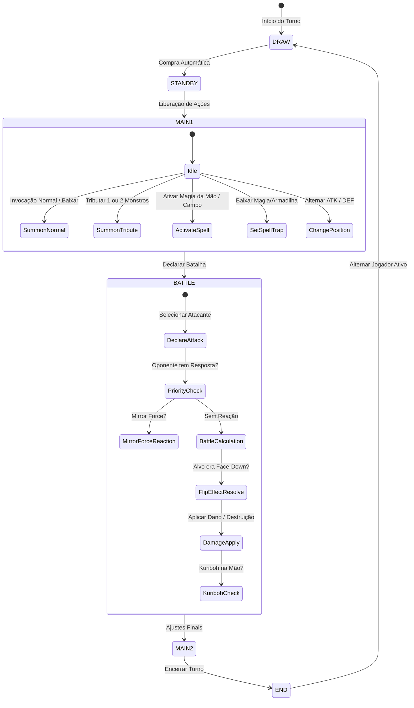
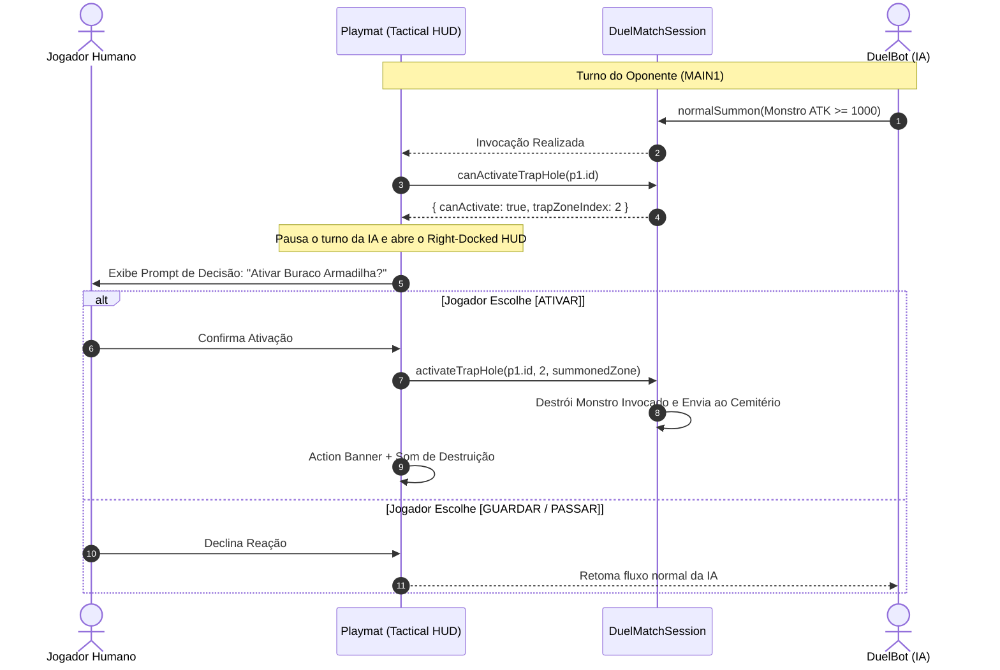
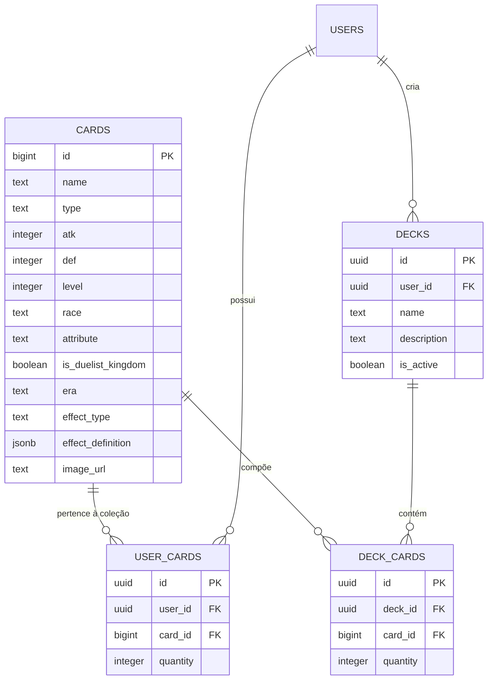

# 🎴 Yu-Gi-Oh! Duelist Kingdom Engine (Retro Simulator)

[](https://www.typescriptlang.org/)
[](https://react.dev/)
[](https://vitejs.dev/)
[-729B1B.svg?logo=vitest)](https://vitest.dev/)
[](https://tailwindcss.com/)
[](https://supabase.com/)
[](https://conventionalcommits.org)

Simulador tático completo de duelos retrô inspirado no arco clássico do **Reino dos Duelistas (*Yu-Gi-Oh! Duelist Kingdom*)** e no aclamado jogo **Yu-Gi-Oh! Forbidden Memories (PS1)**. Desenvolvido com arquitetura modular de alta performance em **TypeScript**, **React 18**, **Supabase (PostgreSQL + RLS)**, **Howler.js** para áudio adaptativo e suíte de testes unitários contínuos com **Vitest** (131/131 testes aprovados).

---

## 📑 Tabela de Conteúdos
1. [Visão Geral do Sistema](#-visão-geral-do-sistema)
2. [Arquitetura Geral do Jogo](#-arquitetura-geral-do-jogo)
   - [Diagrama de Arquitetura em Camadas](#diagrama-de-arquitetura-em-camadas)
   - [O Palácio da Memória (Memory Palace Hexagonal)](#o-palácio-da-memória-memory-palace-hexagonal)
   - [Fluxo da Máquina de Estados de Duelo](#fluxo-da-máquina-de-estados-de-duelo)
   - [Janela de Prioridade e Observer de Armadilhas](#janela-de-prioridade-e-observer-de-armadilhas)
3. [Conceitos de Engenharia de Software Implementados](#-conceitos-de-engenharia-de-software-implementados)
   - [Design Patterns (Padrões de Projeto)](#design-patterns-padrões-de-projeto)
   - [Princípios SOLID](#princípios-solid)
   - [Algoritmos e Estruturas de Dados](#algoritmos-e-estruturas-de-dados)
   - [Segurança e Resiliência (Security by Design)](#segurança-e-resiliência-security-by-design)
   - [Performance e Otimização Web](#performance-e-otimização-web)
   - [Engenharia de Áudio com Howler.js](#engenharia-de-áudio-com-howlerjs)
4. [Estrutura de Pastas e Módulos](#-estrutura-de-pastas-e-módulos)
5. [Modelagem de Dados e Banco de Dados (Supabase)](#-modelagem-de-dados-e-banco-de-dados-supabase)
6. [Catálogo da Onda 1 e Starter Decks](#-catálogo-da-onda-1-e-starter-decks)
7. [Como Executar o Projeto](#-como-executar-o-projeto)
8. [Suíte de Testes Automatizados](#-suíte-de-testes-automatizados)

---

## 🌟 Visão Geral do Sistema

O projeto recria a autenticidade das regras clássicas e táticas de Yu-Gi-Oh!, com suporte a:
- **Partidas PvE Inteligentes:** IA de duelo (`DuelBot`) capaz de invocar por sacrifício, ativar magias de controle de campo (Buraco Negro, Pote da Ganância), reagir com armadilhas (Buraco Armadilha, Força Espelho) e calcular ataques ótimos.
- **Construtor Visual de Decks (`DeckBuilder`):** Catálogo da Onda 1 com mais de 200 cartas oficiais homologadas, busca instantânea, filtros por tipo/nível, limite oficial de 3 cópias por carta e persistência sincronizada (Supabase + localStorage fallback).
- **Mesa Tática 3D (`Playmat`):** Right-Docked Tactical HUD sem backdrops obstrutivos, perspectiva 3D nas cartas, animações de investida física (*Lunge*), vibração de impacto (*Camera Shake*), auras protetoras e Action Banners de ativação com miniatura metálica de 40x56px.
- **Áudio Adaptativo Clássico:** Trilhas sonoras originais de Forbidden Memories integradas via `SoundtrackManager` (Menu Principal, Duelo com rotação fluida entre *Egypt in Ruins* e *Password*, Fanfarras de Vitória e Derrota) e efeitos sonoros dedicados para cada ação mecânica.

---

## 🏛️ Arquitetura Geral do Jogo

O sistema segue o modelo de **Arquitetura Limpa / Hexagonal (Ports & Adapters)**, desacoplando o motor de regras (`src/duel/`) de qualquer dependência visual de renderização (React) ou protocolo de persistência (Supabase/localStorage).

### Diagrama de Arquitetura em Camadas



---

### O Palácio da Memória (Memory Palace Hexagonal)

A governança do projeto é estruturada segundo o **Memory Palace** (`docs/memory-palace/PALACE.md`), onde cada domínio técnico atua como uma câmara autônoma:



- **Câmara 0 (`cybersecurity`):** Row Level Security (RLS) no Supabase, sanitização de catálogos e gestão de segredos via `.env`.
- **Câmara 1 (`planner`):** Arquitetura de transição de fases e planejamento tático.
- **Câmara 2 (`engineer-backend`):** Motores puros de regra (`DuelMatchSession`, `DuelRuleEngine`, `action-handlers.ts`, `DeckService`).
- **Câmara 3 (`engineer-frontend`):** Interface tática gamer anos 2000, layout responsivo e Right-Docked Tactical HUD.
- **Câmara 4 (`tester`):** Cultura AAA (*Arrange, Act, Assert*) com zero regressão em 131 testes automatizados.
- **Câmara 5 (`gamer`):** Física de investida (*Lunge Delta*), ciclo de áudio Howler.js e IA de combate do Bot.

---

### Fluxo da Máquina de Estados de Duelo

O turno segue rigorosamente as fases canônicas de Yu-Gi-Oh!, encapsuladas na máquina de estados de `DuelMatchSession`:



---

### Janela de Prioridade e Observer de Armadilhas

Ao contrário de engines simples que disparam ações automaticamente, este motor implementa **Janelas de Prioridade Reativas (*Priority Windows*)**:



---

## 🧠 Conceitos de Engenharia de Software Implementados

### Design Patterns (Padrões de Projeto)

#### 1. Strategy Pattern & Command Pattern (`action-handlers.ts`)
Os efeitos de cartas deixaram de ser instruções *hardcoded* espalhadas pelo código e foram desacoplados em manipuladores de ação declarativos. Cada efeito implementa uma assinatura uniforme via `ActionExecutionContext`:
```typescript
export interface ActionExecutionContext {
  cardInstance: CardInstance;
  player: PlayerDuelState;
  opponent: PlayerDuelState;
  targetUids?: string[];
  randomIntFn?: (maxExclusive: number) => number;
  logFn?: (message: string) => void;
  session?: any;
}
```
A engine despacha a execução dinamicamente no registro `ACTION_HANDLERS`:
- `BOOST_ATK`: Avaliação dinâmica contextual (ex: Buster Blader ganhando +500 ATK por Dragão no campo/cemitério adversário).
- `DESTROY_MONSTER`: Destruição direcionada ou seletiva (ex: Man-Eater Bug).
- `RETURN_TO_HAND`: Devolução com suporte a múltiplos alvos (ex: Penguin Soldier).
- `WABOKU_SHIELD`: Ativação de imunidade global de dano e destruição no turno.
- `TRIGGER_MIRROR_FORCE`: Destruição em massa de atacantes.
- `COIN_TOSS_CLEAR`: Mecânica 50/50 com auto-destruição e dano de queima (*Time Wizard*).

#### 2. Observer Pattern / Priority Prompts (`Playmat.tsx`)
A mesa de duelo observa os eventos de invocação, declaração de ataque e cálculo de dano, interrompendo o ciclo de execução assíncrono para dar prioridade ao usuário:
- **Buraco Armadilha (*Trap Hole*):** Observa invocações de monstros com ATK $\ge 1000$.
- **Força Espelho (*Mirror Force*):** Observa a declaração de ataque do adversário.
- **Kuriboh:** Observa a aplicação de dano de batalha fatal ou direto.
- **Waboku:** Observa cliques manuais livres nas armadilhas baixadas durante o turno do oponente.

#### 3. State Pattern (`DuelMatchSession.ts`)
O duelo evolui por meio de transições de fase estritas (`DRAW`, `STANDBY`, `MAIN1`, `BATTLE`, `MAIN2`, `END`) com validações de regras por estado:
- Ataques só podem ser declarados na fase `BATTLE`.
- Invocações normais e ativações de cartas mágicas de velocidade 1 só ocorrem em `MAIN1` ou `MAIN2`.
- Alternância de posição de batalha (`ATTACK` $\leftrightarrow$ `DEFENSE`) permitida apenas 1 vez por turno e antes do monstro atacar.

#### 4. Factory Method (`starter-decks.ts`)
Instanciação padronizada de instâncias de cartas com identificadores únicos em partida (`uid = crypto.randomUUID()`):
```typescript
export function createYugiDeck(): CardData[] { ... }
export function createKaibaDeck(): CardData[] { ... }
```

#### 5. Repository & Service Pattern (`deck-service.ts` e `deckStorage.ts`)
Isolamento absoluto entre lógica de negócios de decks e as camadas de persistência:
- `DeckService`: Regras de negócio de montagem, limites de 3 cópias por carta, 3 decks personalizados por duelista e sincronização com PostgreSQL/Supabase.
- Fallback automático para `localStorage` em caso de usuário não autenticado ou indisponibilidade de rede.

#### 6. Singleton Pattern (`SoundtrackManager.ts`)
Instância única de controle de áudio orquestrando crossfades, volume mestre e controle de fila contínua (*playlist*) sem duplicidade de instâncias Howler.

---

### Princípios SOLID

| Princípio | Aplicação no Projeto |
| :--- | :--- |
| **S - Single Responsibility** | Separação estrita entre o cálculo matemático de batalha (`DuelRuleEngine`), o ciclo de vida da sessão (`DuelMatchSession`), a IA de decisão (`DuelBot`), os manipuladores de efeitos (`action-handlers.ts`) e a persistência (`DeckService`). |
| **O - Open/Closed** | Novas cartas e magias são adicionadas ao catálogo via definições JSON (`effectDefinition: { action: "GAIN_LP", value: 1000 }`), sem necessidade de modificar a lógica interna de combate do motor. |
| **L - Liskov Substitution** | Todos os `ActionHandler` respeitam contratos idênticos de entrada e saída, podendo ser intercambiados ou combinados sem afetar o despachador da sessão. |
| **I - Interface Segregation** | Contratos enxutos e estritos (`CardData`, `CardInstance`, `PlayerDuelState`, `BattleResult`, `DeckModel`, `PriorityPrompt`), evitando interfaces gordas e dados desnecessários. |
| **D - Dependency Inversion** | O `DeckService` aceita contratos abstratos `StorageLike` e clientes injetáveis de Supabase, facilitando testes unitários sem acoplamento a infraestrutura externa. |

---

### Algoritmos e Estruturas de Dados

#### 1. Embaralhamento Criptográfico Fisher-Yates
Em vez do tradicional `Math.random()` suscetível a previsibilidade e vícios estatísticos, os decks são embaralhados utilizando o algoritmo **Fisher-Yates** alimentado por entropia criptográfica via `crypto.getRandomValues()` e 3 passadas de lavagem/corte (*riffle shuffle*):
```typescript
private shuffleDeck(deck: CardInstance[]): void {
  for (let i = deck.length - 1; i > 0; i--) {
    const randomBuffer = new Uint32Array(1);
    crypto.getRandomValues(randomBuffer);
    const j = randomBuffer[0] % (i + 1);
    [deck[i], deck[j]] = [deck[j], deck[i]];
  }
}
```

#### 2. Vetores Trigonométricos para Física de Ataque (Lunge Delta)
A animação de investida do monstro atacante contra o defensor calcula em tempo real o vetor cartesiano $(\Delta x, \Delta y)$ entre os elementos DOM das zonas:
```typescript
const calculateLungeDelta = (isPlayerAttacking: boolean, attackerIdx: number, targetIdx: number | null) => {
  // Coleta os bounding rects das zonas e projeta a investida física no clímax do impacto (280ms)
};
```

#### 3. Deduplicação e Sanitização em $O(N)$
O catálogo de cartas assegura integridade referencial através de tabelas hash (`Map` e `Set`), eliminando IDs e nomes colidentes com complexidade temporal linear.

---

### Segurança e Resiliência (Security by Design)

1. **Row Level Security (RLS) no PostgreSQL:**
   - Tabelas `public.decks`, `public.user_cards` e `public.deck_cards` protegidas no nível do banco. Usuários só podem ler e escrever seus próprios registros (`auth.uid() = user_id`).
2. **Sanitização de Entradas e Regras de Negócio:**
   - Validação estrita de limites: máximo de 3 cópias da mesma carta por deck (`MAX_CARD_COPIES = 3`) e máximo de 3 decks personalizados (`MAX_CUSTOM_DECKS = 3`).
3. **Imutabilidade e Isolamento de Memória:**
   - `CardInstance` recebe clones profundos dos dados estáticos, impedindo que mutações temporárias de ATK em partida afetem o catálogo mestre.

---

### Performance e Otimização Web

- **Right-Docked Tactical HUD:** Modais táticos ancorados à direita com `w-72 sm:w-84 max-h-[80vh] flex flex-col animate-slideInRight`, sem backdrops bloqueadores (`fixed inset-0 bg-black/80`), permitindo visibilidade de 100% da mesa.
- **Renderização Eficiente no DeckBuilder:** Mais de 200 cartas renderizadas com `loading="lazy"`, `decoding="async"`, scroll suave e filtros instantâneos memorizados.
- **Aceleração por Hardware:** Transformações CSS 3D (`perspective`, `rotateY`, `transform-style: preserve-3d`) para cartas viradas e animações de destruição.
- **Gestão Rigorosa de Timers:** Registro e cancelamento centralizado de timers (`scheduleTimer` / `clearAllTimers`) para prevenir vazamentos de memória (*memory leaks*) ao desmontar componentes React.

---

### Engenharia de Áudio com Howler.js

O [`SoundtrackManager.ts`](file:///mnt/Dados/Projetos/run/client/src/utils/SoundtrackManager.ts) gerencia o ecossistema sonoro:
1. **Menu Principal:** Tema clássico em loop contínuo.
2. **Fila Sequencial da Partida (*Sequential Queue*):** Ao iniciar o duelo, executa alternância contínua entre as trilhas *Egypt in Ruins* e *Password* (ao disparar o evento `onend`, a próxima faixa inicia sem lacunas de silêncio).
3. **Cortes de Estado Idempotentes:** Ao declarar vitória ou derrota, as músicas de partida são imediatamente interrompidas para a entrada triunfal de *You Win* ou o tema fúnebre de *You Lose*.
4. **Desbloqueio de AudioContext:** Conformidade com as políticas de autoplay dos navegadores modernos (ativação automática no primeiro toque do usuário).

---

## 📂 Estrutura de Pastas e Módulos

```text
.
├── client/                               # Aplicação Frontend (React 18 + Vite)
│   ├── public/                           # Assets estáticos servidos pelo Vite
│   │   ├── audio/                        # Trilhas clássicas de Forbidden Memories (MP3)
│   │   ├── cards/                        # Artes de cartas em alta resolução
│   │   ├── video/                        # Background cinematográfico do menu (banner.mp4)
│   │   └── card-back.jpg                 # Verso canônico de Yu-Gi-Oh!
│   ├── src/
│   │   ├── components/                   # Componentes React de UI / Apresentação
│   │   │   ├── Playmat.tsx               # Mesa de Duelo 3D e Right-Docked Tactical HUD
│   │   │   ├── DeckBuilder.tsx           # Construtor Visual de Decks da Onda 1
│   │   │   ├── GameMenu.tsx              # Menu Principal estilo arcade
│   │   │   ├── SettingsModal.tsx         # Configurações de som e idioma
│   │   │   └── AuthModal.tsx             # Modal de Login / Registro Supabase
│   │   ├── data/
│   │   │   └── duelist-kingdom-catalog.json # Catálogo compilado da Onda 1 (220+ cartas)
│   │   ├── utils/                        # Utilitários de Frontend e Áudio
│   │   │   ├── SoundtrackManager.ts      # Orquestrador de trilhas sonoras Howler.js
│   │   │   ├── soundFX.ts                # Efeitos sonoros táticos (ataque, magia, destruição)
│   │   │   ├── deckStorage.ts            # Gerenciamento local e sincronização de decks
│   │   │   └── settings.ts               # Persistência de preferências de usuário
│   │   ├── App.tsx                       # Roteador de telas e orquestrador raiz
│   │   └── main.tsx                      # Ponto de entrada React DOM
│   └── index.html                        # HTML raiz com estilos globais e animações CSS
├── src/                                  # Motor Central de Regras (Domain Puro - TypeScript)
│   └── duel/
│       ├── effects/
│       │   └── action-handlers.ts        # Strategy Pattern: Handlers de efeitos de cartas
│       ├── card-catalog-service.ts       # Serviço de consulta e enriquecimento de cartas
│       ├── deck-service.ts               # Regras de negócio de montagem e validação de decks
│       ├── duel-bot.ts                   # Inteligência Artificial PvE
│       ├── duel-match-session.ts         # Orquestrador de partida e máquina de estados
│       ├── duel-rule-engine.ts           # Motor matemático puro de combate e tributos
│       ├── duel-types.ts                 # Tipagens e contratos TypeScript do domínio
│       └── starter-decks.ts              # Decks clássicos pré-montados de Yugi e Kaiba
├── supabase/                             # Infraestrutura de Banco de Dados
│   └── migrations/                       # Migrações SQL versionadas
│       ├── 20261017000000_initial_schema.sql         # Schema base (cards, decks, user_cards)
│       ├── 20261017010000_add_duelist_kingdom_era.sql # Marcação da era Reino dos Duelistas
│       └── 20261017020000_add_card_effects.sql       # Colunas effect_type e effect_definition JSONB
├── scripts/                              # Scripts operacionais e de sincronização
│   ├── export-wave1-catalog.ts           # Compilador estático do catálogo da Onda 1
│   ├── sync-cards.ts                     # Sincronizador de cartas com YGOPRODeck
│   └── tag_duelist_kingdom.py            # Marcação oficial dos sets clássicos no banco
├── docs/                                 # Documentação Técnica
│   └── memory-palace/
│       └── PALACE.md                     # Mapa cognitivo compartilhado (Memory Palace)
├── package.json                          # Metadados e dependências do projeto
├── tsconfig.json                         # Configuração estrita do compilador TypeScript
├── vite.config.ts                        # Configuração de build e aliases do Vite
└── vitest.config.ts                      # Configuração da suíte de testes Vitest
```

---

## 🗄️ Modelagem de Dados e Banco de Dados (Supabase)

O esquema relacional garante integridade referencial e performance através de índices especializados:



---

## 🃏 Catálogo da Onda 1 e Starter Decks

O jogo possui catálogo homologado da **Onda 1 do Reino dos Duelistas**, compilado em `client/src/data/duelist-kingdom-catalog.json`:
- **Mais de 220 Cartas Únicas:** Monstros clássicos (Dragão Branco de Olhos Azuis, Mago Negro, Crânio Convocado, Dragão Negro de Olhos Vermelhos, Rei de Duas Cabeças Rex, Guardião Celta), Magias e Armadilhas.
- **Traduções Oficiais em Português:** Campos `namePt` e `descriptionPt` padronizados segundo a nomenclatura canônica consagrada.
- **Metadados Completos:** Atributo, Raça (Dragon, Spellcaster, Fiend, Warrior, etc.), Nível (1 a 8), ATK e DEF.
- **Decks Clássicos Pré-Montados:** Decks de 40 cartas de **Yugi Muto** e **Seto Kaiba** prontos para jogar.

---

## 🚀 Como Executar o Projeto

### Pré-requisitos
- **Node.js:** Versão 18.0 ou superior.
- **NPM:** Gerenciador de pacotes padrão.

### Instalação
Clone o repositório e instale as dependências:
```bash
git clone <url-do-repositorio>
cd run
npm install
```

### Executar em Modo de Desenvolvimento
Inicia a aplicação localmente com hot-reload no Vite:
```bash
npm run dev
```
Abra [http://localhost:3000](http://localhost:3000) no seu navegador.

### Compilar para Produção
Gera os arquivos otimizados em `dist/`:
```bash
npm run build
```

---

## 🧪 Suíte de Testes Automatizados

O projeto mantém uma política rigorosa de **Zero Regressão**, com todos os testes escritos no padrão **AAA (Arrange, Act, Assert)**.

Para executar todos os testes automatizados via **Vitest**:
```bash
npm test
```

### Cobertura Atual das Suítes (131/131 Aprovados):
- `src/duel/duel-rule-engine.test.ts`: Matemática de batalha, posições de combate, cálculo de dano refletido e regras de tributos (Nível 5-6 $\rightarrow$ 1 sacrifício, Nível 7+ $\rightarrow$ 2 sacrifícios).
- `src/duel/duel-match-session.test.ts`: Fases do duelo, resolução prioritária de efeitos FLIP (Man-Eater Bug, Penguin Soldier), efeitos contínuos por raça (Buster Blader), ativação de magias (Raigeki, Dark Hole, Pote da Ganância, Dian Keto, Hinotama, De-Spell) e armadilhas (Mirror Force, Waboku, Trap Hole).
- `src/duel/deck-service.test.ts`: Regras de construção de deck (limite de 3 cópias, 3 decks personalizados, alternância atômica de deck ativo, validação de 40 monstros da Onda 1).
- `client/src/utils/deckStorage.test.ts`: Sanitização de catálogo, integridade de IDs, ausência de duplicatas e persistência local.
- `client/src/utils/SoundtrackManager.test.ts`: Inicialização de áudio, fila contínua de reprodução e tratamento de mute/volume.
- `client/src/utils/settings.test.ts`: Persistência de idioma e áudio no `localStorage`.

---

## 📜 Licença e Créditos

Este projeto foi construído para fins educacionais, de pesquisa em arquitetura de software e tributo aos fãs de Yu-Gi-Oh!.
- **Artes e Marcas de Cartas:** © Studio Dice / SHUEISHA, TV TOKYO, KONAMI.
- **Trilhas Sonoras Clássicas:** Yu-Gi-Oh! Forbidden Memories (Konami, 1999).
