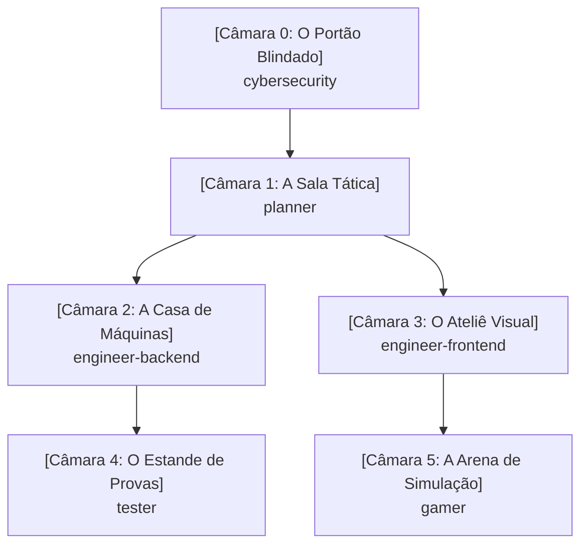

# Memory Palace do Workspace (Mapa Cognitivo)

Este documento atua como o **Palácio da Memória Compartilhado** do sistema. Todos os agentes e desenvolvedores consultam e atualizam este mapa para manter a coerência arquitetural, mecânicas, regras de segurança e decisões do projeto.

---

## 🏛️ Mapa Geral das Câmaras

---

## 🚪 Câmara 0: O Portão Blindado (`cybersecurity`)
- **Âncora Mnemônica:** Uma guarita de titânio com leitor biométrico, alarme anti-vazamento de segredos e scanner de infecções.
- **Responsabilidade:** Segurança preventiva (Secure by Design) e reativa.
- **Artefatos e Registros:**
  - *Cofre de Segredos:* Toda chave/credencial reside em `.env` ou gerenciador de segredos.
  - *Filtro de Desinfecção:* Validação rígida na entrada e sanitização na saída.
  - *Tábua dos 10 Mandamentos:* OWASP Top 10 permanentemente auditado.

---

## 🗺️ Câmara 1: A Sala Tática (`planner`)
- **Âncora Mnemônica:** Um mezanino envidraçado com mesas de guerra e telas holográficas. O Tech Lead usa luvas brancas cerimoniais (modo Read-Only: não escreve código funcional).
- **Responsabilidade:** Análise de trade-offs, roadmap, decomposição de tarefas e geração de prompts.
- **Artefatos e Registros:**
  - *Painel de Épicas:* Decomposição em etapas incrementais e planos de ação.
  - *Fábrica de Prompts:* Modelagem de instruções prontas para serem distribuídas aos engenheiros.

---

## ⚙️ Câmara 2: A Casa de Máquinas (`engineer-backend`)
- **Âncora Mnemônica:** O porão industrial com barulho de turbinas e módulos isolados que se comunicam por cabos blindados.
- **Responsabilidade:** APIs, lógica de negócios, modelagem de dados, arquitetura em camadas e performance.
- **Artefatos e Registros:**
  - *Gavetas Herméticas:* Clean Architecture / Hexagonal — regra de negócio não acopla a banco ou protocolo.
  - *Expedição Consolidada:* Prevenção a consultas N+1 com batching e caching.
  - *Caixa-Preta:* Logs e telemetria estruturados.

---

## 🎨 Câmara 3: O Ateliê Visual (`engineer-frontend`)
- **Âncora Mnemônica:** Um estúdio de design com monitores calibrados e piso geométrico em malha de 8px.
- **Responsabilidade:** Interfaces do usuário (UI), experiência (UX), acessibilidade (a11y) e responsividade.
- **Artefatos e Registros:**
  - *Mesa Pantográfica Mobile-First:* Telas concebidas para mobile e expandidas para desktop.
  - *Sensor de Acessibilidade:* Marcação HTML semântica, contraste e suporte a leitores de tela/teclado.
  - *Catálogo de Componentes:* Elementos atômicos e reutilizáveis.

---

## 🎯 Câmara 4: O Estande de Provas (`tester`)
- **Âncora Mnemônica:** Um estande de tiro com sensores automáticos de impacto e armadilhas para fantasmas de bugs passados.
- **Responsabilidade:** Qualidade contínua, testes unitários, testes de integração e testes de não-regressão.
- **Artefatos e Registros:**
  - *Bancada Tríplice AAA:* Todo teste segue `Arrange`, `Act`, `Assert`.
  - *Cela de Regressão:* Todo bug corrigido recebe um teste com o número da issue antes da resolução.

---

## 🕹️ Câmara 5: A Arena de Simulação (`gamer`)
- **Âncora Mnemônica:** Um fliperama de alta tecnologia com metrônomo calibrado em 60/120 FPS e cestas fechadas de reciclagem de objetos.
- **Responsabilidade:** Game loops, física 2D/3D, renderização Canvas/WebGL e eficiência extrema de CPU/GPU.
- **Artefatos e Registros:**
  - *O Metrônomo do Tempo:* `requestAnimationFrame` estrito com cálculo de `delta time`.
  - *Ciclo Fechado (Object Pool):* Reutilização de objetos de memória para evitar engasgos do Garbage Collector.

---

## 📜 Histórico de Decisões do Palácio (Log Mnemônico)
| Data | Câmara | Registro da Decisão / Mudança | Agente Responsável |
| :--- | :--- | :--- | :--- |
| 2026-10-17 | Todas | Instituição do Memory Palace como fonte de verdade | Todos |
| 2026-10-17 | engineer-backend | Modelagem SQL de cards, user_cards, decks, deck_cards e sincronizador YGOPRODeck com rate limit e blacklist | engineer-backend |
| 2026-10-17 | engineer-backend | Fluxo de Login -> Menu de Jogo (Solo vs Bot e Online Futuro) e controle de Posição de Batalha (Vertical ATK / Horizontal DEF) com rotação no tabuleiro | engineer-backend |
| 2026-10-17 | engineer-backend | Diversificação de cartas dos decks clássicos (máximo 3 cópias por carta, 15+ arquétipos únicos) e embaralhamento com algoritmo Fisher-Yates com alta entropia (crypto.getRandomValues e 3 passadas de riffle/wash) | engineer-backend |
| 2026-10-17 | engineer-backend | Implementação do sistema de Invocação-Tributo (Sacrifício): 1 monstro para nível 5-6 e 2 monstros para nível 7+, com seleção interativa de monstros no campo, liberação de zonas, envio ao cemitério e testes unitários AAA | engineer-backend |
| 2026-10-17 | engineer-backend | Regra de invocação e ataque: monstro invocado no turno atual não pode declarar ataque (só ataca a partir do próximo turno), com bloqueio no motor de regras, IA do Bot, badge visual 'Invocado ⏳' e testes unitários de regressão | engineer-backend |
| 2026-10-17 | engineer-backend | Simplificação da invocação: monstros entram diretamente em Posição de Ataque (sem popup de pergunta) e o jogador pode clicar no monstro no seu campo para alternar livremente (ATK <-> DEF) durante a Fase Principal. Ao entrar na Fase de Batalha ou passar o turno, a posição fica travada e prevalece até o próximo turno do jogador | engineer-backend |
| 2026-10-17 | engineer-backend | Implementação de filtro e marcação da era Reino dos Duelistas no Supabase (colunas is_duelist_kingdom e era com índices), mapeamento dos sets oficiais (LOB, MRD, MRL/SRL, PSV, SDY, SDK, SDJ, SDP) com blacklist, script tag_duelist_kingdom.py e CardCatalogService em TypeScript | engineer-backend |
| 2026-10-17 | engineer-backend | Execução da marcação da era Reino dos Duelistas no Supabase: 493 cartas clássicas oficiais marcadas com is_duelist_kingdom = true e era = 'DUELIST_KINGDOM' com 0 vazamentos de Fusões, Exodia ou Deuses Egípcios | engineer-backend |
| 2026-10-17 | engineer-backend | Adição das colunas effect_type (TEXT) e effect_definition (JSONB) com índices na tabela public.cards, população dos 5 primeiros efeitos clássicos (Buster Blader, Man-Eater Bug, Penguin Soldier, Kuriboh, Time Wizard) e tipagem rigorosa em duel-types.ts e starter-decks.ts | engineer-backend |
| 2026-10-17 | engineer-backend | Validação e auditoria no Supabase: migração aplicada com sucesso, colunas ativas e 5/5 efeitos JSONB validados via API PostgREST | engineer-backend |
| 2026-10-17 | tester | Criação da suíte de testes unitários (AAA / Vitest) cobrindo regras de sacrifício, cálculo de batalha e ataque direto | tester |
| 2026-10-17 | engineer-backend / planner | Verificação e validação do banco Supabase: schema aplicado com sucesso, bucket card-images criado e catálogo com 11.652 cartas sincronizadas | planner |
| 2026-10-17 | gamer | Implementação da sessão da partida (DuelMatchSession), Decks Clássicos e IA do Bot PvE (DuelBot) | gamer |
| 2026-10-17 | engineer-frontend | Construção da Mesa de Duelo (Playmat.tsx) com React/Tailwind, zonas espelhadas, cálculo de LP em tempo real e integração do Bot PvE | engineer-frontend |
| 2026-10-17 | engineer-frontend | Redesign visual da Mesa: Estilo Dark/Anime anos 2000 (Olho do Milênio, gradientes roxo/dourado), cartas ampliadas com arte integral nítida e painel lateral de inspeção | engineer-frontend |
| 2026-10-17 | gamer / tester / frontend | Resolução dos 6 itens: Início direto em MAIN1, escolha de Posição (ATK/DEF) com rotação 90°, mudança 1x/turno, contagem regressiva de 5s, botão de desistência, chat traduzido e 18 testes unitários passando | planner |
| 2026-10-17 | engineer-backend | Implementação de ATK dinâmico contínuo (Buster Blader +500 por Dragão no campo/cemitério adversário) e resolução de efeitos FLIP (Man-Eater Bug destrói atacante, Penguin Soldier devolve atacante à mão), atualização da IA do Bot (DuelBot) e 30 testes unitários AAA passando | engineer-backend |
| 2026-10-17 | engineer-backend | Implementação dos efeitos de Kuriboh (HAND_TRIGGER: canActivateKuriboh, activateKuriboh descartando da mão para o cemitério e anulando dano) e Time Wizard (IGNITION: activateTimeWizard com roleta 50/50 em crypto.getRandomValues, HEADS destrói campo oponente, TAILS destrói campo do usuário e aplica burn damage da metade do ATK total, flag hasUsedEffectThisTurn resetada no endTurn) e 33 testes unitários AAA passando | engineer-backend |
| 2026-10-17 | engineer-backend | Adição e padronização das traduções oficiais consagradas em Português (Brasil) para os campos namePt e descriptionPt em todas as 29 cartas clássicas de starter-decks.ts (Yugi e Kaiba), mantendo 33/33 testes passando | engineer-backend |
| 2026-10-17 | engineer-backend | Implementação da mecânica Face-Down (virado para baixo) com turnSet, trava de flip manual no mesmo turno, disparo de efeito FLIP ao virar manualmente, resolução prioritária de efeitos FLIP antes do combate (interrupção do ataque e preservação do monstro defensor caso o atacante seja destruído ou devolvido à mão), atualização da IA DuelBot para baixar cartas FLIP ocultas em DEFENSE e 36 testes unitários AAA passando | engineer-backend |
| 2026-10-17 | engineer-backend | Ajuste da assinatura de changeMonsterPosition para retornar PositionChangeResult ({ success, flipped, flipEffect: { cardName, action, targetCardUid, targetName } }), acionamento reativo do banner de efeito visual no Playmat e 38 testes unitários AAA passando | engineer-backend |
| 2026-10-17 | engineer-backend | Implementação de retorno inteligente no efeito FLIP do Soldado Pinguim: devolução automática de todos os alvos se <= 2 monstros no campo do oponente, suporte a selectedTargetUids (alvos específicos do jogador) se > 2 monstros, e seleção inteligente automática dos 2 monstros com maior ATK efetivo para a IA/Bot, com 41 testes unitários AAA passando | engineer-backend |
| 2026-10-17 | engineer-backend | Desacoplamento dos efeitos de cartas de duel-match-session.ts para Action Handlers modulares (src/duel/effects/action-handlers.ts): BOOST_ATK, DESTROY_MONSTER, RETURN_TO_HAND, PREVENT_DAMAGE, COIN_TOSS_CLEAR acionados via effectDefinition declarativa, eliminando verificações rígidas por ID de carta e garantindo 100% de aprovação (47/47 testes passando) | engineer-backend |
| 2026-10-18 | gamer | Implementação da trilha sonora dinâmica por camadas verticais (Vertical Layering) em TypeScript com Howler.js no client/src/utils/AdaptiveSoundtrackManager.ts (stems: baseRhythm, orchestralMelody, epicChoir), Web Audio API estrito (html5: false), transição suave com crossfade de 2000ms, idempotência de estados e suíte de testes unitários desacoplada com 60/60 testes aprovados | gamer |
| 2026-10-18 | gamer | Síntese e geração dos 3 stems de áudio em loop em D Egyptian Frígio/Harmônico a 120 BPM com 8.00s exatos (stem_base_rhythm, stem_orchestral_melody, stem_epic_choir em MP3 e WebM Opus) em client/public/audio/soundtrack/, validados na suíte Vitest com 61/61 testes passando | gamer |
| 2026-10-18 | gamer | Substituição das trilhas sintéticas pelas trilhas sonoras consagradas de Yu-Gi-Oh! Forbidden Memories (Menu Principal, Partidas [Egypt in Ruins / Password], Fanfarra de Vitória [You Win] e Tema de Derrota [You Lose]) em MP3 de alta definição em client/public/audio/, integradas via SoundtrackManager com suíte de testes Vitest aprovada (60/60) | gamer |
| 2026-10-18 | engineer-backend | Integração de Magias e Armadilhas clássicas (Pot of Greed, Dark Hole, Fissure, Trap Hole) aos Starter Decks balanceados com 40 cartas (34 monstros + 6 magias/armadilhas) e implementação dos métodos canActivateTrapHole e activateTrapHole em DuelMatchSession, com 68/68 testes automatizados passando | engineer-backend |

| 2026-10-18 | gamer | Ajuste de sincronização da exibição de fim de partida no Playmat.tsx: correção do identificador de vencedor (match.winnerPlayerId), disparo imediato das faixas de Vitória (You Win) e Derrota (You Lose) em sincronia com o modal temático comemorativo/fúnebre e 60/60 testes passando | gamer |
| 2026-10-18 | engineer-frontend | Padronização e calibração responsiva do Playmat: zonas de monstros e magias com dimensões fixas permanentes (vazio vs ocupado), resolução do clipping horizontal de cartas em DEF via .card-defense-wrapper e .card-defense-img (overflow-visible), enquadramento estrito em 100vh com eliminação de corte no rodapé (mão/deck/cemitério) e ErrorBoundary em App.tsx | engineer-frontend |
| 2026-10-18 | engineer-backend | Refinamento das regras oficiais: triggersFlip estritamente condicionado a wasFaceDown && FLIP em declareAttack (monstros revelados de face para cima em defesa não ativam efeito ao serem atacados) e trava de ativação de Cartas Mágicas baixadas no campo no mesmo turno (turnSet < currentTurn em activateSpell), com 72/72 testes passando | engineer-backend |
| 2026-10-18 | gamer | Implementação de fila sequencial de reprodução durante a partida no SoundtrackManager (alternância fluida e contínua via onend entre Egypt in Ruins e Password sem sobreposição de áudio), preservação estrita da música do Menu Principal, garantia de parada de todas as outras faixas ao disparar Vitória (You Win) ou Derrota (You Lose) e 73/73 testes passando | gamer |
| 2026-10-18 | gamer | Blindagem do loop de ataque do bot no Playmat.tsx (animação e banner FLIP estritamente condicionados a wasFaceDown) e ativação de Cartas Mágicas baixadas viradas para baixo no campo em turnos anteriores (turnSet < currentTurn) via modal de confirmação no Playmat, com 73/73 testes passando | gamer |
| 2026-10-18 | engineer-frontend | Resolução do bug da carta invisível via triggerCardDestruction com reset de 600ms, seleção tática de alvos para Man-Eater Bug e Penguin Soldier com >= 1 monstro adversário com confirmação explícita obrigatória, e orquestração de timing de VFX de contra-ataque FLIP do bot contra o jogador no Playmat.tsx | engineer-frontend |
| 2026-10-18 | engineer-backend | Auditoria arquitetural completa e correção dos defeitos D1 (escudo de dano do Kuriboh integrado a declareAttack destruindo o monstro vencido sem aplicar dano aos LPs), D2 (DuelBot avaliando e jogando Pot of Greed, Fissure, Dark Hole, baixando e ativando Trap Hole reativamente em invocações com ATK >= 1000), D4 (isolamento estrito de BOOST_ATK em getEffectiveAttack), D5 (metadado oficial race adicionado às 33 cartas de starter-decks.ts incluindo Hyozanryu como Dragon e exclusão de monstros virados para baixo no campo do oponente), D6 (registro e limpeza centralizada de timers no Playmat.tsx) e D8 (guarda level >= 1 em normalSummon), com 81/81 testes automatizados passando | engineer-backend |
| 2026-10-18 | engineer-frontend | Reformulação do Menu Principal (GameMenu.tsx) com background cinematográfico de vídeo (/video/banner.mp4), layout lateral estilo arcade à esquerda, novo sistema de persistência de configurações de usuário em localStorage (settings.ts: soundMuted e language), modal temático SettingsModal.tsx e limpeza do cabeçalho da mesa de duelo no Playmat.tsx com ícone sutil de engrenagem, com 87/87 testes passando | engineer-frontend |
| 2026-10-18 | tester | Criação do DeckService (src/duel/deck-service.ts) e suíte unitária rigorosa no padrão AAA (src/duel/deck-service.test.ts) validando: limite máximo de 3 decks personalizados por usuário, limite máximo de 3 cópias por carta no mesmo deck (regra oficial de Yu-Gi-Oh!), alternância atômica de deck principal (setMainDeck) com isActive exclusivo, e listagem de decks incluindo os pré-montados clássicos imutáveis (Yugi e Kaiba com 40 cartas e isPrebuilt: true), com 91/91 testes passando | tester |
| 2026-10-18 | engineer-backend | Implementação completa de DeckService (src/duel/deck-service.ts) com getUserDecks, saveCustomDeck, setMainDeck e deleteCustomDeck, integração com Supabase (tabelas decks e deck_cards) e fallback automático transparente para localStorage, unificando contratos DeckModel e UserDeck com o frontend (deckStorage.ts) e 93/93 testes passando | engineer-backend |
| 2026-10-18 | engineer-frontend | Implementação do Construtor Visual de Decks (DeckBuilder.tsx), persistência local (deckStorage.ts + deckStorage.test.ts), habilitação do botão '🎴 Construtor de Decks' em GameMenu.tsx e injeção do Deck Principal ativo do usuário em DuelMatchSession via App.tsx e Playmat.tsx, com 97/97 testes passando | engineer-frontend |
| 2026-10-18 | tester | Criação da suíte de testes de Resolução Declarativa e Genérica de Efeitos em duel-match-session.test.ts (padrão AAA) validando: FLIP DESTROY_MONSTER genérico com alvo tático único, FLIP RETURN_TO_HAND genérico com múltiplos alvos seletivos, e efeito contínuo BOOST_ATK genérico condicional por raça (Dragon) com alocação dinâmica sem checagem de nome hardcoded, alcançando a marca histórica de 100/100 testes unitários aprovados | tester |
| 2026-10-18 | engineer-frontend | Refatoração do sistema de seleção tática de alvos no Playmat.tsx para ser 100% genérico e orientado a metadados: eliminação das variáveis hardcoded (isManEater e isPenguin), criação de checkCardRequiresTargeting(card) e getTacticalActionMeta(action) baseados em card.data.effectDefinition?.target, suporte unificado a monstros FLIP e magias com alvo na interface de mira ('ESCOLHER ALVO' e 'CONFIRMAR'), com 100/100 testes aprovados | engineer-frontend |
| 2026-10-18 | engineer-backend | Eliminação de todos os acoplamentos rígidos por ID/nome de carta em duel-match-session.ts, padronização declarativa de effectDefinition em starter-decks.ts (MAN_EATER_BUG, PENGUIN_SOLDIER, BUSTER_BLADER), adição dos handlers genéricos GAIN_LP, INFLICT_DAMAGE e DESTROY_SPELL_TRAP em action-handlers.ts e testes unitários AAA correspondentes, com 103/103 testes aprovados | engineer-backend |
| 2026-10-18 | engineer-frontend | Integração do Catálogo Consolidado da Onda 1 (duelist-kingdom-catalog.json com 493 cartas e fallback clássico) em deckStorage.ts, otimização de alta performance em DeckBuilder.tsx para 200+ cartas (contentVisibility, lazy loading, decoding async, scroll suave, busca instantânea e filtros por tipo com contadores), badge 'Catálogo: 200+ cartas disponíveis' e expansão do inspetor lateral com arte ampliada e atributos completos, com 104/104 testes aprovados | engineer-frontend |
| 2026-10-18 | engineer-backend | Implementação e execução do script de consolidação do Catálogo Estático da Onda 1 (scripts/export-wave1-catalog.ts): consulta estrita a public.cards no Supabase (is_duelist_kingdom = true, Normal Monsters + Efeitos Homologados), mapeamento para CardData (id, name, type, level, attack, defense, race, attribute, imageUrl, description), mesclagem com traduções canônicas de CLASSIC_CARDS (namePt, descriptionPt, effectDefinition) e exportação validada de 207 cartas sem corrupções para client/src/data/duelist-kingdom-catalog.json, com 104/104 testes aprovados | engineer-backend |
| 2026-10-18 | tester | Criação da suíte de testes de validação da integridade do Catálogo Expandido da Onda 1 em deckStorage.test.ts (>200 cartas únicas, atributos e stats válidos, categorização perfeita de filtros MONSTER/SPELL/TRAP) e da suíte de montagem e duelo em deck-service.test.ts (validação de deck de 40 monstros normais da Onda 1 com Red-Eyes Black Dragon e Two-Headed King Rex, execução de invocação normal nível <= 4, invocação-tributo nível 7 com 2 sacrifícios, combate e cálculo de dano na DuelMatchSession sem erros), com 109/109 testes unitários aprovados e zero regressão | tester |
| 2026-10-18 | tester | Criação da suíte de testes de Ativação de Magias da Sub-Onda 2A em duel-match-session.test.ts no padrão AAA cobrindo: GAIN_LP com Dian Keto (+1000 LP e envio ao cemitério), INFLICT_DAMAGE com Hinotama/Ookazi (dano direto de 500 LP e condição de vitória/game over ao zerar LPs do oponente) e DESTROY_SPELL_TRAP com De-Spell (destruição e envio de carta na zona de M/A do oponente para o cemitério com mira tática selecionada), com 112/112 testes unitários aprovados | tester |
| 2026-10-18 | engineer-backend | Consolidação do despacho de efeitos da Sub-Onda 2A em duel-match-session.ts (GAIN_LP, INFLICT_DAMAGE com encerramento de duelo em LP <= 0, e DESTROY_SPELL_TRAP com alvo seletivo), inclusão canônica das 7 cartas em CLASSIC_CARDS (starter-decks.ts) e SUB_WAVE_2A_METADATA em export-wave1-catalog.ts (Dian Keto, Sparks, Hinotama, Raimei, Final Flame, Ookazi, De-Spell) e re-exportação bem-sucedida de duelist-kingdom-catalog.json com 215 cartas válidas, alcançando 113/113 testes aprovados | engineer-backend |
| 2026-10-18 | engineer-frontend | Implementação de feedback visual e sonoro para ativação de magias da Sub-Onda 2A em Playmat.tsx (GAIN_LP com som de cura, float verde +value LP nos pontos de vida e notificação temática; INFLICT_DAMAGE com som de impacto, floating damage no oponente, câmera tremor e notificação de dano direto; DESTROY_SPELL_TRAP com fluxo de mira tática nas zonas de M/A do adversário, VFX de desintegração e som de destruição) e exibição impecável das novas magias em DeckBuilder.tsx sob a aba 'MAGIA' (com descrição completa, pill de tipo ✨ Carta Mágica sem caixas 0/0 de ATK/DEF e botões rápidos de adição/remoção), com 113/113 testes passando e build de produção 100% íntegro | engineer-frontend |
