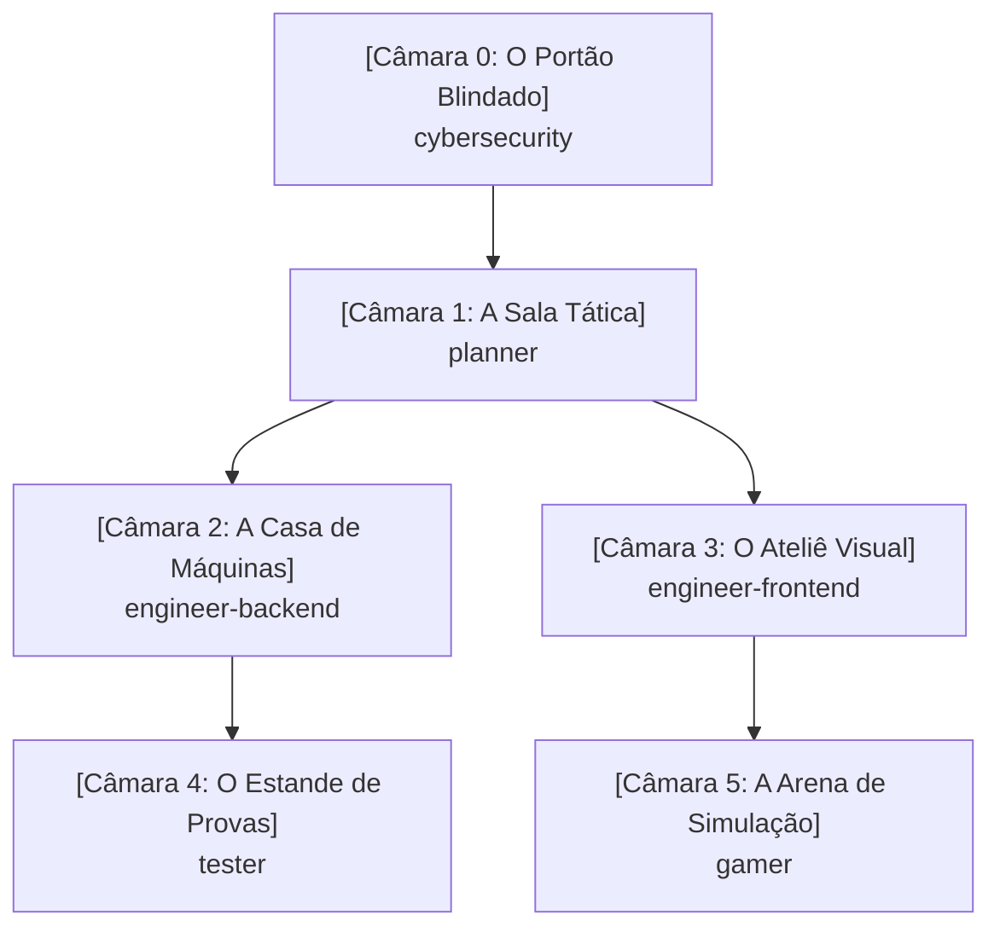

# Memory Palace do Workspace (Mapa Cognitivo)

Este documento atua como o **Palácio da Memória Compartilhado** do sistema. Todos os agentes e desenvolvedores consultam e atualizam este mapa para manter a coerência arquitetural, mecânicas, regras de segurança e decisões do projeto.

---

## 🏛️ Mapa Geral das Câmaras

---

## 🚪 Câmara 0: O Portão Blindado (`cybersecurity`)
- **Âncora Mnemônica:** Uma guarita de titânio com leitor biométrico, alarme anti-vazamento de segredos e scanner de infecções.
- **Responsabilidade:** Segurança preventiva (Secure by Design) e reativa.
- **Artefatos e Registros:**
  - *Cofre de Segredos:* Toda chave/credencial reside em `.env` ou gerenciador de segredos.
  - *Filtro de Desinfecção:* Validação rígida na entrada e sanitização na saída.
  - *Tábua dos 10 Mandamentos:* OWASP Top 10 permanentemente auditado.

---

## 🗺️ Câmara 1: A Sala Tática (`planner`)
- **Âncora Mnemônica:** Um mezanino envidraçado com mesas de guerra e telas holográficas. O Tech Lead usa luvas brancas cerimoniais (modo Read-Only: não escreve código funcional).
- **Responsabilidade:** Análise de trade-offs, roadmap, decomposição de tarefas e geração de prompts.
- **Artefatos e Registros:**
  - *Painel de Épicas:* Decomposição em etapas incrementais e planos de ação.
  - *Fábrica de Prompts:* Modelagem de instruções prontas para serem distribuídas aos engenheiros.

---

## ⚙️ Câmara 2: A Casa de Máquinas (`engineer-backend`)
- **Âncora Mnemônica:** O porão industrial com barulho de turbinas e módulos isolados que se comunicam por cabos blindados.
- **Responsabilidade:** APIs, lógica de negócios, modelagem de dados, arquitetura em camadas e performance.
- **Artefatos e Registros:**
  - *Gavetas Herméticas:* Clean Architecture / Hexagonal — regra de negócio não acopla a banco ou protocolo.
  - *Expedição Consolidada:* Prevenção a consultas N+1 com batching e caching.
  - *Caixa-Preta:* Logs e telemetria estruturados.

---

## 🎨 Câmara 3: O Ateliê Visual (`engineer-frontend`)
- **Âncora Mnemônica:** Um estúdio de design com monitores calibrados e piso geométrico em malha de 8px.
- **Responsabilidade:** Interfaces do usuário (UI), experiência (UX), acessibilidade (a11y) e responsividade.
- **Artefatos e Registros:**
  - *Mesa Pantográfica Mobile-First:* Telas concebidas para mobile e expandidas para desktop.
  - *Sensor de Acessibilidade:* Marcação HTML semântica, contraste e suporte a leitores de tela/teclado.
  - *Catálogo de Componentes:* Elementos atômicos e reutilizáveis.

---

## 🎯 Câmara 4: O Estande de Provas (`tester`)
- **Âncora Mnemônica:** Um estande de tiro com sensores automáticos de impacto e armadilhas para fantasmas de bugs passados.
- **Responsabilidade:** Qualidade contínua, testes unitários, testes de integração e testes de não-regressão.
- **Artefatos e Registros:**
  - *Bancada Tríplice AAA:* Todo teste segue `Arrange`, `Act`, `Assert`.
  - *Cela de Regressão:* Todo bug corrigido recebe um teste com o número da issue antes da resolução.

---

## 🕹️ Câmara 5: A Arena de Simulação (`gamer`)
- **Âncora Mnemônica:** Um fliperama de alta tecnologia com metrônomo calibrado em 60/120 FPS e cestas fechadas de reciclagem de objetos.
- **Responsabilidade:** Game loops, física 2D/3D, renderização Canvas/WebGL e eficiência extrema de CPU/GPU.
- **Artefatos e Registros:**
  - *O Metrônomo do Tempo:* `requestAnimationFrame` estrito com cálculo de `delta time`.
  - *Ciclo Fechado (Object Pool):* Reutilização de objetos de memória para evitar engasgos do Garbage Collector.

---

## 📜 Histórico de Decisões do Palácio (Log Mnemônico)
| Data | Câmara | Registro da Decisão / Mudança | Agente Responsável |
| :--- | :--- | :--- | :--- |
| 2026-10-17 | Todas | Instituição do Memory Palace como fonte de verdade | Todos |
| 2026-10-17 | engineer-backend | Modelagem SQL de cards, user_cards, decks, deck_cards e sincronizador YGOPRODeck com rate limit e blacklist | engineer-backend |
| 2026-10-17 | engineer-backend | Fluxo de Login -> Menu de Jogo (Solo vs Bot e Online Futuro) e controle de Posição de Batalha (Vertical ATK / Horizontal DEF) com rotação no tabuleiro | engineer-backend |
| 2026-10-17 | engineer-backend | Diversificação de cartas dos decks clássicos (máximo 3 cópias por carta, 15+ arquétipos únicos) e embaralhamento com algoritmo Fisher-Yates com alta entropia (crypto.getRandomValues e 3 passadas de riffle/wash) | engineer-backend |
| 2026-10-17 | engineer-backend | Implementação do sistema de Invocação-Tributo (Sacrifício): 1 monstro para nível 5-6 e 2 monstros para nível 7+, com seleção interativa de monstros no campo, liberação de zonas, envio ao cemitério e testes unitários AAA | engineer-backend |
| 2026-10-17 | engineer-backend | Regra de invocação e ataque: monstro invocado no turno atual não pode declarar ataque (só ataca a partir do próximo turno), com bloqueio no motor de regras, IA do Bot, badge visual 'Invocado ⏳' e testes unitários de regressão | engineer-backend |
| 2026-10-17 | engineer-backend | Simplificação da invocação: monstros entram diretamente em Posição de Ataque (sem popup de pergunta) e o jogador pode clicar no monstro no seu campo para alternar livremente (ATK <-> DEF) durante a Fase Principal. Ao entrar na Fase de Batalha ou passar o turno, a posição fica travada e prevalece até o próximo turno do jogador | engineer-backend |
| 2026-10-17 | engineer-backend | Implementação de filtro e marcação da era Reino dos Duelistas no Supabase (colunas is_duelist_kingdom e era com índices), mapeamento dos sets oficiais (LOB, MRD, MRL/SRL, PSV, SDY, SDK, SDJ, SDP) com blacklist, script tag_duelist_kingdom.py e CardCatalogService em TypeScript | engineer-backend |
| 2026-10-17 | engineer-backend | Execução da marcação da era Reino dos Duelistas no Supabase: 493 cartas clássicas oficiais marcadas com is_duelist_kingdom = true e era = 'DUELIST_KINGDOM' com 0 vazamentos de Fusões, Exodia ou Deuses Egípcios | engineer-backend |
| 2026-10-17 | engineer-backend | Adição das colunas effect_type (TEXT) e effect_definition (JSONB) com índices na tabela public.cards, população dos 5 primeiros efeitos clássicos (Buster Blader, Man-Eater Bug, Penguin Soldier, Kuriboh, Time Wizard) e tipagem rigorosa em duel-types.ts e starter-decks.ts | engineer-backend |
| 2026-10-17 | engineer-backend | Validação e auditoria no Supabase: migração aplicada com sucesso, colunas ativas e 5/5 efeitos JSONB validados via API PostgREST | engineer-backend |
| 2026-10-17 | tester | Criação da suíte de testes unitários (AAA / Vitest) cobrindo regras de sacrifício, cálculo de batalha e ataque direto | tester |
| 2026-10-17 | engineer-backend / planner | Verificação e validação do banco Supabase: schema aplicado com sucesso, bucket card-images criado e catálogo com 11.652 cartas sincronizadas | planner |
| 2026-10-17 | gamer | Implementação da sessão da partida (DuelMatchSession), Decks Clássicos e IA do Bot PvE (DuelBot) | gamer |
| 2026-10-17 | engineer-frontend | Construção da Mesa de Duelo (Playmat.tsx) com React/Tailwind, zonas espelhadas, cálculo de LP em tempo real e integração do Bot PvE | engineer-frontend |
| 2026-10-17 | engineer-frontend | Redesign visual da Mesa: Estilo Dark/Anime anos 2000 (Olho do Milênio, gradientes roxo/dourado), cartas ampliadas com arte integral nítida e painel lateral de inspeção | engineer-frontend |
| 2026-10-17 | gamer / tester / frontend | Resolução dos 6 itens: Início direto em MAIN1, escolha de Posição (ATK/DEF) com rotação 90°, mudança 1x/turno, contagem regressiva de 5s, botão de desistência, chat traduzido e 18 testes unitários passando | planner |
| 2026-10-17 | engineer-backend | Implementação de ATK dinâmico contínuo (Buster Blader +500 por Dragão no campo/cemitério adversário) e resolução de efeitos FLIP (Man-Eater Bug destrói atacante, Penguin Soldier devolve atacante à mão), atualização da IA do Bot (DuelBot) e 30 testes unitários AAA passando | engineer-backend |
| 2026-10-17 | engineer-backend | Implementação dos efeitos de Kuriboh (HAND_TRIGGER: canActivateKuriboh, activateKuriboh descartando da mão para o cemitério e anulando dano) e Time Wizard (IGNITION: activateTimeWizard com roleta 50/50 em crypto.getRandomValues, HEADS destrói campo oponente, TAILS destrói campo do usuário e aplica burn damage da metade do ATK total, flag hasUsedEffectThisTurn resetada no endTurn) e 33 testes unitários AAA passando | engineer-backend |
| 2026-10-17 | engineer-backend | Adição e padronização das traduções oficiais consagradas em Português (Brasil) para os campos namePt e descriptionPt em todas as 29 cartas clássicas de starter-decks.ts (Yugi e Kaiba), mantendo 33/33 testes passando | engineer-backend |
| 2026-10-17 | engineer-backend | Implementação da mecânica Face-Down (virado para baixo) com turnSet, trava de flip manual no mesmo turno, disparo de efeito FLIP ao virar manualmente, resolução prioritária de efeitos FLIP antes do combate (interrupção do ataque e preservação do monstro defensor caso o atacante seja destruído ou devolvido à mão), atualização da IA DuelBot para baixar cartas FLIP ocultas em DEFENSE e 36 testes unitários AAA passando | engineer-backend |
| 2026-10-17 | engineer-backend | Ajuste da assinatura de changeMonsterPosition para retornar PositionChangeResult ({ success, flipped, flipEffect: { cardName, action, targetCardUid, targetName } }), acionamento reativo do banner de efeito visual no Playmat e 38 testes unitários AAA passando | engineer-backend |
| 2026-10-17 | engineer-backend | Implementação de retorno inteligente no efeito FLIP do Soldado Pinguim: devolução automática de todos os alvos se <= 2 monstros no campo do oponente, suporte a selectedTargetUids (alvos específicos do jogador) se > 2 monstros, e seleção inteligente automática dos 2 monstros com maior ATK efetivo para a IA/Bot, com 41 testes unitários AAA passando | engineer-backend |
| 2026-10-17 | engineer-backend | Desacoplamento dos efeitos de cartas de duel-match-session.ts para Action Handlers modulares (src/duel/effects/action-handlers.ts): BOOST_ATK, DESTROY_MONSTER, RETURN_TO_HAND, PREVENT_DAMAGE, COIN_TOSS_CLEAR acionados via effectDefinition declarativa, eliminando verificações rígidas por ID de carta e garantindo 100% de aprovação (47/47 testes passando) | engineer-backend |
| 2026-10-18 | gamer | Implementação da trilha sonora dinâmica por camadas verticais (Vertical Layering) em TypeScript com Howler.js no client/src/utils/AdaptiveSoundtrackManager.ts (stems: baseRhythm, orchestralMelody, epicChoir), Web Audio API estrito (html5: false), transição suave com crossfade de 2000ms, idempotência de estados e suíte de testes unitários desacoplada com 60/60 testes aprovados | gamer |
| 2026-10-18 | gamer | Síntese e geração dos 3 stems de áudio em loop em D Egyptian Frígio/Harmônico a 120 BPM com 8.00s exatos (stem_base_rhythm, stem_orchestral_melody, stem_epic_choir em MP3 e WebM Opus) em client/public/audio/soundtrack/, validados na suíte Vitest com 61/61 testes passando | gamer |
| 2026-10-18 | gamer | Substituição das trilhas sintéticas pelas trilhas sonoras consagradas de Yu-Gi-Oh! Forbidden Memories (Menu Principal, Partidas [Egypt in Ruins / Password], Fanfarra de Vitória [You Win] e Tema de Derrota [You Lose]) em MP3 de alta definição em client/public/audio/, integradas via SoundtrackManager com suíte de testes Vitest aprovada (60/60) | gamer |
| 2026-10-18 | engineer-backend | Integração de Magias e Armadilhas clássicas (Pot of Greed, Dark Hole, Fissure, Trap Hole) aos Starter Decks balanceados com 40 cartas (34 monstros + 6 magias/armadilhas) e implementação dos métodos canActivateTrapHole e activateTrapHole em DuelMatchSession, com 68/68 testes automatizados passando | engineer-backend |

| 2026-10-18 | gamer | Ajuste de sincronização da exibição de fim de partida no Playmat.tsx: correção do identificador de vencedor (match.winnerPlayerId), disparo imediato das faixas de Vitória (You Win) e Derrota (You Lose) em sincronia com o modal temático comemorativo/fúnebre e 60/60 testes passando | gamer |
| 2026-10-18 | engineer-frontend | Padronização e calibração responsiva do Playmat: zonas de monstros e magias com dimensões fixas permanentes (vazio vs ocupado), resolução do clipping horizontal de cartas em DEF via .card-defense-wrapper e .card-defense-img (overflow-visible), enquadramento estrito em 100vh com eliminação de corte no rodapé (mão/deck/cemitério) e ErrorBoundary em App.tsx | engineer-frontend |
| 2026-10-18 | engineer-backend | Refinamento das regras oficiais: triggersFlip estritamente condicionado a wasFaceDown && FLIP em declareAttack (monstros revelados de face para cima em defesa não ativam efeito ao serem atacados) e trava de ativação de Cartas Mágicas baixadas no campo no mesmo turno (turnSet < currentTurn em activateSpell), com 72/72 testes passando | engineer-backend |
| 2026-10-18 | gamer | Implementação de fila sequencial de reprodução durante a partida no SoundtrackManager (alternância fluida e contínua via onend entre Egypt in Ruins e Password sem sobreposição de áudio), preservação estrita da música do Menu Principal, garantia de parada de todas as outras faixas ao disparar Vitória (You Win) ou Derrota (You Lose) e 73/73 testes passando | gamer |
| 2026-10-18 | gamer | Blindagem do loop de ataque do bot no Playmat.tsx (animação e banner FLIP estritamente condicionados a wasFaceDown) e ativação de Cartas Mágicas baixadas viradas para baixo no campo em turnos anteriores (turnSet < currentTurn) via modal de confirmação no Playmat, com 73/73 testes passando | gamer |
| 2026-10-18 | engineer-frontend | Resolução do bug da carta invisível via triggerCardDestruction com reset de 600ms, seleção tática de alvos para Man-Eater Bug e Penguin Soldier com >= 1 monstro adversário com confirmação explícita obrigatória, e orquestração de timing de VFX de contra-ataque FLIP do bot contra o jogador no Playmat.tsx | engineer-frontend |
| 2026-10-18 | engineer-backend | Auditoria arquitetural completa e correção dos defeitos D1 (escudo de dano do Kuriboh integrado a declareAttack destruindo o monstro vencido sem aplicar dano aos LPs), D2 (DuelBot avaliando e jogando Pot of Greed, Fissure, Dark Hole, baixando e ativando Trap Hole reativamente em invocações com ATK >= 1000), D4 (isolamento estrito de BOOST_ATK em getEffectiveAttack), D5 (metadado oficial race adicionado às 33 cartas de starter-decks.ts incluindo Hyozanryu como Dragon e exclusão de monstros virados para baixo no campo do oponente), D6 (registro e limpeza centralizada de timers no Playmat.tsx) e D8 (guarda level >= 1 em normalSummon), com 81/81 testes automatizados passando | engineer-backend |
| 2026-10-18 | engineer-frontend | Reformulação do Menu Principal (GameMenu.tsx) com background cinematográfico de vídeo (/video/banner.mp4), layout lateral estilo arcade à esquerda, novo sistema de persistência de configurações de usuário em localStorage (settings.ts: soundMuted e language), modal temático SettingsModal.tsx e limpeza do cabeçalho da mesa de duelo no Playmat.tsx com ícone sutil de engrenagem, com 87/87 testes passando | engineer-frontend |
| 2026-10-18 | tester | Criação do DeckService (src/duel/deck-service.ts) e suíte unitária rigorosa no padrão AAA (src/duel/deck-service.test.ts) validando: limite máximo de 3 decks personalizados por usuário, limite máximo de 3 cópias por carta no mesmo deck (regra oficial de Yu-Gi-Oh!), alternância atômica de deck principal (setMainDeck) com isActive exclusivo, e listagem de decks incluindo os pré-montados clássicos imutáveis (Yugi e Kaiba com 40 cartas e isPrebuilt: true), com 91/91 testes passando | tester |
| 2026-10-18 | engineer-backend | Implementação completa de DeckService (src/duel/deck-service.ts) com getUserDecks, saveCustomDeck, setMainDeck e deleteCustomDeck, integração com Supabase (tabelas decks e deck_cards) e fallback automático transparente para localStorage, unificando contratos DeckModel e UserDeck com o frontend (deckStorage.ts) e 93/93 testes passando | engineer-backend |
| 2026-10-18 | engineer-frontend | Implementação do Construtor Visual de Decks (DeckBuilder.tsx), persistência local (deckStorage.ts + deckStorage.test.ts), habilitação do botão '🎴 Construtor de Decks' em GameMenu.tsx e injeção do Deck Principal ativo do usuário em DuelMatchSession via App.tsx e Playmat.tsx, com 97/97 testes passando | engineer-frontend |
| 2026-10-18 | tester | Criação da suíte de testes de Resolução Declarativa e Genérica de Efeitos em duel-match-session.test.ts (padrão AAA) validando: FLIP DESTROY_MONSTER genérico com alvo tático único, FLIP RETURN_TO_HAND genérico com múltiplos alvos seletivos, e efeito contínuo BOOST_ATK genérico condicional por raça (Dragon) com alocação dinâmica sem checagem de nome hardcoded, alcançando a marca histórica de 100/100 testes unitários aprovados | tester |
| 2026-10-18 | engineer-frontend | Refatoração do sistema de seleção tática de alvos no Playmat.tsx para ser 100% genérico e orientado a metadados: eliminação das variáveis hardcoded (isManEater e isPenguin), criação de checkCardRequiresTargeting(card) e getTacticalActionMeta(action) baseados em card.data.effectDefinition?.target, suporte unificado a monstros FLIP e magias com alvo na interface de mira ('ESCOLHER ALVO' e 'CONFIRMAR'), com 100/100 testes aprovados | engineer-frontend |
| 2026-10-18 | engineer-backend | Eliminação de todos os acoplamentos rígidos por ID/nome de carta em duel-match-session.ts, padronização declarativa de effectDefinition em starter-decks.ts (MAN_EATER_BUG, PENGUIN_SOLDIER, BUSTER_BLADER), adição dos handlers genéricos GAIN_LP, INFLICT_DAMAGE e DESTROY_SPELL_TRAP em action-handlers.ts e testes unitários AAA correspondentes, com 103/103 testes aprovados | engineer-backend |
| 2026-10-18 | engineer-frontend | Integração do Catálogo Consolidado da Onda 1 (duelist-kingdom-catalog.json com 493 cartas e fallback clássico) em deckStorage.ts, otimização de alta performance em DeckBuilder.tsx para 200+ cartas (contentVisibility, lazy loading, decoding async, scroll suave, busca instantânea e filtros por tipo com contadores), badge 'Catálogo: 200+ cartas disponíveis' e expansão do inspetor lateral com arte ampliada e atributos completos, com 104/104 testes aprovados | engineer-frontend |
| 2026-10-18 | engineer-backend | Implementação e execução do script de consolidação do Catálogo Estático da Onda 1 (scripts/export-wave1-catalog.ts): consulta estrita a public.cards no Supabase (is_duelist_kingdom = true, Normal Monsters + Efeitos Homologados), mapeamento para CardData (id, name, type, level, attack, defense, race, attribute, imageUrl, description), mesclagem com traduções canônicas de CLASSIC_CARDS (namePt, descriptionPt, effectDefinition) e exportação validada de 207 cartas sem corrupções para client/src/data/duelist-kingdom-catalog.json, com 104/104 testes aprovados | engineer-backend |
| 2026-10-18 | tester | Criação da suíte de testes de validação da integridade do Catálogo Expandido da Onda 1 em deckStorage.test.ts (>200 cartas únicas, atributos e stats válidos, categorização perfeita de filtros MONSTER/SPELL/TRAP) e da suíte de montagem e duelo em deck-service.test.ts (validação de deck de 40 monstros normais da Onda 1 com Red-Eyes Black Dragon e Two-Headed King Rex, execução de invocação normal nível <= 4, invocação-tributo nível 7 com 2 sacrifícios, combate e cálculo de dano na DuelMatchSession sem erros), com 109/109 testes unitários aprovados e zero regressão | tester |
| 2026-10-18 | tester | Criação da suíte de testes de Ativação de Magias da Sub-Onda 2A em duel-match-session.test.ts no padrão AAA cobrindo: GAIN_LP com Dian Keto (+1000 LP e envio ao cemitério), INFLICT_DAMAGE com Hinotama/Ookazi (dano direto de 500 LP e condição de vitória/game over ao zerar LPs do oponente) e DESTROY_SPELL_TRAP com De-Spell (destruição e envio de carta na zona de M/A do oponente para o cemitério com mira tática selecionada), com 112/112 testes unitários aprovados | tester |
| 2026-10-18 | engineer-backend | Consolidação do despacho de efeitos da Sub-Onda 2A em duel-match-session.ts (GAIN_LP, INFLICT_DAMAGE com encerramento de duelo em LP <= 0, e DESTROY_SPELL_TRAP com alvo seletivo), inclusão canônica das 7 cartas em CLASSIC_CARDS (starter-decks.ts) e SUB_WAVE_2A_METADATA em export-wave1-catalog.ts (Dian Keto, Sparks, Hinotama, Raimei, Final Flame, Ookazi, De-Spell) e re-exportação bem-sucedida de duelist-kingdom-catalog.json com 215 cartas válidas, alcançando 113/113 testes aprovados | engineer-backend |
| 2026-10-18 | engineer-frontend | Implementação de feedback visual e sonoro para ativação de magias da Sub-Onda 2A em Playmat.tsx (GAIN_LP com som de cura, float verde +value LP nos pontos de vida e notificação temática; INFLICT_DAMAGE com som de impacto, floating damage no oponente, câmera tremor e notificação de dano direto; DESTROY_SPELL_TRAP com fluxo de mira tática nas zonas de M/A do adversário, VFX de desintegração e som de destruição) e exibição impecável das novas magias em DeckBuilder.tsx sob a aba 'MAGIA' (com descrição completa, pill de tipo ✨ Carta Mágica sem caixas 0/0 de ATK/DEF e botões rápidos de adição/remoção), com 113/113 testes passando e build de produção 100% íntegro | engineer-frontend |
| 2026-10-18 | tester | Criação da suíte de testes automatizados para as Cartas Lendárias do Grupo A em duel-match-session.test.ts no padrão AAA: Raigeki (DESTROY_OPPONENT_MONSTERS destruindo todos os monstros do oponente sem afetar os do jogador), Mirror Force (canActivateMirrorForce e activateMirrorForce destruindo todos os monstros em ATTACK, poupando monstros em DEFENSE e cancelando o ataque sem dano) e Waboku (canActivateWaboku, activateWaboku, prevenção total de destruição de monstros em batalha e 0 dano aos LPs), totalizando 116/116 testes aprovados com zero regressão | tester |
| 2026-10-18 | engineer-backend | Implementação e homologação das regras do Grupo A (Raigeki, Mirror Force, Waboku, Reinforcements, Castle Walls): criação de DESTROY_OPPONENT_MONSTERS, TRIGGER_MIRROR_FORCE, WABOKU_SHIELD, BOOST_ATK_TRAP e BOOST_DEF_TRAP em action-handlers.ts; adição de canActivateMirrorForce, activateMirrorForce, canActivateWaboku, activateWaboku e flag isWabokuActiveForPlayerId com reset em endTurn em duel-match-session.ts; integração de interrupção de combate e imunidade de destruição/dano de batalha em declareAttack; adição dos metadados a CLASSIC_CARDS (starter-decks.ts) e GROUP_A_METADATA (scripts/export-wave1-catalog.ts); re-exportação do catálogo duelist-kingdom-catalog.json com 220 cartas consolidadas e 119/119 testes automatizados aprovados | engineer-backend |
| 2026-10-18 | engineer-frontend | Implementação de suporte visual e sonoro às Cartas Lendárias do Grupo A em Playmat.tsx: Raigeki com soundFX.playAttackStrike(), camera shake e animação/overlay de tempestade de relâmpagos aniquilando monstros adversários; Mirror Force com prompt de reação interativo ("⚡ Deseja ativar Força Espelho (Mirror Force) em resposta ao ataque?"), banner comemorativo reflexivo ("🪞 FORÇA ESPELHO ATIVADA! O ataque foi refletido e todos os monstros de ataque do adversário foram destruídos!"), som de explosão e suporte para a IA/Bot também ativar Mirror Force contra ataques do jogador; e Waboku com aura protetora azul/branca (ring sky-300, glow etéreo interno e badge '🕊️ AURA SAGRADA') indicando proteção sagrada contra destruição e dano durante o turno, com 119/119 testes passando e build limpo | engineer-frontend |
| 2026-10-18 | tester | Criação da suíte de testes de regressão contra cartas duplicadas e imagens inconsistentes em deckStorage.test.ts (padrão AAA): validação de 0 duplicatas de IDs e nomes em getAllCatalogCards(), validação estrita de correspondência de ID com a URL da imagem (eliminando Gate Guardian 25833572 associado a Waboku e padronizando Castle Walls 44209392 e Waboku 12607053), validação de 0 contaminação entre tipos de carta nos filtros e função de sanitização/deduplicação resiliente sanitizeCatalogCards(), com 123/123 testes automatizados aprovados | tester |
| 2026-10-19 | tester | Criação da suíte de testes de Liberdade de Decisão de Ativação de Armadilhas em duel-match-session.test.ts (padrão AAA): validação da retenção estratégica de Trap Hole (canActivateTrapHole retorna true mas a carta não é consumida nem o monstro destruído sem ação explícita do jogador), ativação voluntária confirmada de Trap Hole (destruição do monstro e envio ao cemitério) e ativação manual de Waboku no turno do oponente com escudo de dano zero e imunidade de destruição em combate, totalizando 126/126 testes aprovados com 100% de sucesso | tester |
| 2026-10-19 | engineer-backend | Refatoração das regras de armadilhas desacoplando checagem e auto-execução: DuelBot.tryActivateTrapHoleOnSummon restringido estritamente à IA (recusando auto-ativação para o jogador humano), criação de DuelBot.checkPlayerReactionOnSummon para consulta pura de reações na invocação do oponente, e implementação canônica de activateWaboku em DuelMatchSession validando face-down, turnSet < currentTurn e card Waboku, ativando isWabokuActiveForPlayerId = playerId, movendo para o cemitério e registrando no log, com garantia de ativação de armadilhas no turno do adversário e 131/131 testes passando | engineer-backend |
| 2026-10-19 | engineer-frontend | Implementação da Janela de Prioridade e Prompts de Decisão do Jogador (Observer / Priority Prompts) em Playmat.tsx: pausa no turno do Bot ao invocar monstro com ATK >= 1000 com abertura de modal temático de reação ("🕳️ O oponente invocou [Nome] (ATK [X]). Deseja ativar sua carta armadilha [Buraco Armadilha]?") com botões [Ativar Armadilha ⚡] e [Guardar / Passar ❌], ativação livre de Armadilhas baixadas (Waboku) no turno do oponente (turnSet < currentTurn) com VFX sagrado azul/branco e som mágico, e unificação de todos os prompts de reação (Trap Hole, Mirror Force, Kuriboh, Waboku) em um modal cinematográfico no estilo Master Duel com glow dinâmico por tipo de carta, badge animada e preview de arte, com 131/131 testes passando e build 100% íntegro | engineer-frontend |
| 2026-10-19 | engineer-frontend | Refatoração visual e espacial do HUD no Playmat.tsx: ancoragem dos modais de escolha (spellChoiceModal, summonChoiceModal e priorityPrompt) no flanco direito (Right-Docked Tactical HUD: fixed right-4 sm:right-6 top-24 z-50 w-72 sm:w-84 max-h-[80vh] flex flex-col animate-slideInRight) sem backdrops escuros de bloqueio total do campo, novo Action Banner gamer no topo com miniatura 40x56px com borda metálica, nome dourado e descrição da jogada para ativações de Magias, Armadilhas e Efeitos FLIP, e erradicação completa de emojis em toda a mesa substituídos por insígnias e textos técnicos estilizados em CSS ([ATK], [DEF], [ATIVAR], [INVOCADO], [DESTRUIR], [RETORNAR], [PRONTO]), com 131/131 testes Vitest aprovados e build íntegro | engineer-frontend |
| 2026-10-21 | Todas | Criação da documentação arquitetural mestra em README.md detalhando o ecossistema do simulador: arquitetura hexagonal em camadas, máquina de estados do duelo, janela de prioridade/observer de armadilhas, catálogo estático da Onda 1, padrões de projeto (Strategy, Observer, State, Factory, Repository, Singleton), princípios SOLID, algoritmos (Fisher-Yates com crypto.getRandomValues, vetores de lunge), segurança com Supabase RLS e cobertura total da suíte de 131 testes AAA | planner |
| 2026-10-24 | gamer / engineer-frontend | Inicialização da Fase 1 da Arena 3D: instalação e integração do Three.js r186 com pipeline nativo three/webgpu (WebGPURenderer com fallback WebGL2), criação do componente DuelArena3D.tsx com câmera isométrica inclinada estilo Master Duel, iluminação atmosférica mística e grid dourado, mantendo 131/131 testes Vitest aprovados e build limpo | gamer |
| 2026-10-24 | gamer / engineer-frontend | Implementação das Fases 2 & 3 da Arena 3D em DuelArena3D.tsx: instanciação de malhas 3D de cartas (BoxGeometry com texturas frente/verso e sRGB color space), mapeamento espacial das 20 zonas (5x4), rotação de 90° para modo de defesa, elevação no hover e inspeção, raycasting para cliques e hovers interativos, sistema de partículas de desintegração para cartas destruídas (ParticleVFX com buffer geometry), animação de investida 3D de ataque (Lunge 3D lerp), animação de impacto e transição de revelação (Flip), mantendo 133/133 testes passando | gamer |
| 2026-10-24 | engineer-frontend / gamer / tester | Implementação da Fase 4: Integração Seamless e Arquitetura Dual-Layer da Arena 3D no Playmat.tsx: chave seletora com persistência em localStorage (ygo_arena_3d_enabled) permitindo alternar instantaneamente entre Arena 3D (Three.js/WebGPU) e Modo Clássico 2.5D, unificação da barra central de controle de fases e botões táticos, integração dos despachos de clique e hover com os fluxos de combate e invocação do jogo, criação de suíte de testes unitários para DuelArena3D (DuelArena3D.test.ts) e validação de 133/133 testes automatizados (100% aprovados) com build de produção impecável | engineer-frontend |
| 2026-10-24 | gamer / engineer-frontend | Correção do ciclo de vida assíncrono do WebGPURenderer no DuelArena3D.tsx: o Three.js r186 exige obrigatoriamente 'await renderer.init()' antes de invocar 'renderer.render()'; adicionados ref isRendererReadyRef para bloquear frames prévios, fallback automático em cascata para THREE.WebGLRenderer caso a GPU rejeite o adaptador WebGPU, e prop onError no Playmat.tsx para retorno gracioso ao modo 2.5D sem quebra de tela | gamer |
| 2026-10-24 | gamer / engineer-frontend | Resolução da interatividade e colocação de cartas na Arena 3D: eliminação de Stale Closures via onZoneClickRef e onCardHoverRef; sincronização permanente de interactiveObjectsRef com zonas e cartas; ajuste milimétrico das caixas de colisão de zonas (y=0.02) e cartas (y=0.05); debouncing resiliente de click e pointerup sem perda de cliques; realce pulsante dinâmico para zonas válidas de Magias/Armadilhas (validSpellTrapZones); permissão de invocação normal em MAIN1 e MAIN2 com mensagens de aviso transparentes (invocação normal já realizada, zona ocupada) e salvaguarda contra desincronização de estado em executeSummon; 133/133 testes aprovados e build limpo | gamer |
| 2026-10-24 | engineer-frontend | Integração Full-Game do ecossistema 3D WebGPU nas 4 telas principais: AuthModal.tsx (WebGPUBackdrop variant="auth"), GameMenu.tsx (WebGPUBackdrop variant="menu" entre o vídeo do Dragão Branco e a coluna de navegação), DeckBuilder.tsx (WebGPUBackdrop variant="deck" e Card3DShowcase interativo com tilt holográfico no Inspetor de Cartas) e Playmat.tsx (Card3DShowcase no Grimoire quando is3DMode ativo + injeção de contadores 3D de Deck/Cemitério, idioma e activeFieldVfx no DuelArena3D), mantendo 133/133 testes Vitest aprovados e build limpo | engineer-frontend |
| 2026-10-24 | tester | Execução do Épico 4 (Cobertura Completa de Testes Frontend WebGPU no Padrão AAA): criação de webgpuCore.test.ts (detecção de WebGPU, fallback WebGL2 e disposeSceneResources), cardTextureGenerator.test.ts (paletas de molduras clássicas, proxy anti-CORS /api/card-image/, geração e cache de texturas THREE.Texture em PT/EN e clearCardTextureCache), expansão de DuelArena3D.test.ts (20 zonas espaciais, proteção contra stale closures, callbacks de hover/erro, VFX lendários e descritores de combate 3D) e criação de FrontendWebGPU.test.ts (integração end-to-end das 9 telas/componentes 3D e sincronização com DuelMatchSession), alcançando 10 suítes e 164/164 testes automatizados aprovados com build de produção limpo | tester |
| 2026-10-24 | engineer-frontend | Execução do Épico 1 (Hardware Acceleration Guard em App.tsx com verifyHardwareAcceleration e modal temático de bloqueio com instruções Chrome/Firefox) e Épico 3 (Exclusividade 100% 3D e Remoção Total do Modo 2D: substituição do <video> HTML pelo THREE.VideoTexture nativo via WebGPUBackdrop em GameMenu.tsx, remoção completa do tabuleiro/mãos/decks 2D e do botão [3D ON]/[2D] em Playmat.tsx, delegação integral das mãos em leque 3D playerHand/opponentHandCount ao DuelArena3D e HUD compacto superior/inferior), mantendo 164/164 testes aprovados e build limpo | engineer-frontend |
| 2026-10-24 | tester | Expansão das suítes de testes automatizados AAA (webgpuCore.test.ts, DuelArena3D.test.ts e FrontendWebGPU.test.ts) cobrindo verifyHardwareAcceleration (WebGPU, WebGL2 por hardware e bloqueio de SwiftShader/llvmpipe), computeHandCardTransform (leque 3D das mãos do jogador e oponente com elevação/escala ao selecionar/hover), contrato de onHandCardClick e onHardwareError, e ciclo completo 3D Hand-to-Field com DuelMatchSession, alcançando 10 suítes e 173/173 testes aprovados com build de produção limpo | tester |
| 2026-10-24 | engineer-frontend | Redesign completo do HUD de Duelo em Playmat.tsx e DuelArena3D.tsx seguindo fielmente o padrão Yu-Gi-Oh! Master Duel: Arena 3D em tela cheia 100vw x 100vh (`absolute inset-0 z-0`), Placas Angulares de LP nos cantos inferior-esquerdo (Jogador, `playerLpRef`) e superior-direito (Oponente, `opponentLpRef`), Controles redondos de Configurações (`[CFG]`) e Rendição (`[RENDER-SE]`) no canto superior-esquerdo, Painel Flutuante e Recolhível de Inspeção de Cartas na esquerda (cabeçalho com atributo, seção dividida com `Card3DShowcase` + Nível/ATK/DEF lado a lado, e caixa rolável de efeito/lore com suporte a Time Wizard), Orbe Circular de Fase e Turno na direita-centro com botões de Fase de Batalha e Encerrar Turno, Pílula Tática central para confirmação de mira/ataque direto, e Botões Táticos redondos `[INFO]` e `[LOG]` no canto inferior-direito com gavetas flutuantes; 173/173 testes aprovados e build limpo | engineer-frontend |
| 2026-10-24 | tester | Atualização das suítes de testes AAA (DuelArena3D.test.ts e FrontendWebGPU.test.ts) validando o espaçamento ampliado estilo Master Duel em computeHandCardTransform (card[1].x - card[0].x >= 1.5), a invariância das coordenadas da hitbox invisível estacionária contra flicker/oscilação de hover na mão 3D, e o contrato de WebGPUBackdrop variant="menu" (vídeo limpo sem artefato 3D giratório) vs variant="auth", alcançando 10 suítes e 175/175 testes aprovados com build limpo | tester |
| 2026-10-24 | gamer / engineer-frontend | Refinamento estético e ergonômico da Arena 3D (DuelArena3D.tsx) e do HUD (Playmat.tsx): elevação da câmera 3D para (0, 16.2, 9.8) com mão em linha reta (zero fan/rotação) posicionada abaixo da mesa; substituição do orbe circular de fase por um Painel Tático Unificado de Controle de Turno e Fase à direita (`w-44 sm:w-48 bg-[#141210]/95 border-2 border-amber-800/80`) sem estouro de texto; e erradicação total de cores RGB/neon (ciano, azul-celeste, roxo neon) em favor de uma paleta clássica de Pedra Escura, Ferro e Ouro Envelhecido; 10 suítes e 175/175 testes aprovados com build limpo | engineer-frontend |
| 2026-10-24 | tester | Atualização de DuelArena3D.test.ts no padrão AAA validando explicitamente a geometria de mão em linha reta (zero fan / zero arc) em computeHandCardTransform: rotZ === 0 estrito, Y === 0.55 e Z === 7.15 idênticos nas 5 cartas do jogador e Z === -6.15 na mão do oponente, com 10 suítes e 175/175 testes aprovados e build de produção limpo | tester |
| 2026-10-24 | engineer-frontend | Remoção total de efeitos de brilho artificial, reflexo especular (glare) e bordas amarelas brilhantes nas cartas 3D (cardTextureGenerator.ts, DuelArena3D.tsx e Card3DShowcase.tsx): desenho full-bleed 256x372 sem strokeRect amarelo, substituição de MeshStandardMaterial/emissive por MeshBasicMaterial com cores 100% naturais sem estouro de luz, e espaçamento horizontal ampliado (1.52) na mão do oponente; 10 suítes e 175/175 testes aprovados com build limpo | engineer-frontend |
| 2026-10-24 | engineer-frontend / tester | Resolução e validação da remoção imediata da carta da mão ao ser colocada na mesa (Hand-to-Field Sync): passagem de cópias rasas ([...p1.hand], [...p1.monsterZones], [...p1.spellTrapZones]) no Playmat.tsx, inclusão de assinaturas estritas (playerHandSignature e fieldZonesSignature) no DuelArena3D.tsx para forçar re-render instantâneo dos meshes 3D da mão e do campo ao invocar ou baixar cartas, e ampliação da suíte AAA em DuelArena3D.test.ts e FrontendWebGPU.test.ts (10 suítes, 178/178 testes aprovados) | engineer-frontend |
| 2026-10-24 | engineer-frontend | Redesign vertical e ampliação máxima do Inspetor de Cartas no Playmat.tsx e Card3DShowcase.tsx: expansão do painel lateral (w-80 sm:w-88 md:w-92) com arte 3D da carta em escala aumentada (w-56 sm:w-64 md:w-72 h-80 sm:h-92 md:h-[390px]), aproximação de câmera (z=4.85), barra de estrelas de Nível douradas (NÍVEL X ★★★), blocos de ATK/DEF e lore completo; 10 suítes e 178/178 testes aprovados com build limpo | engineer-frontend |
| 2026-10-24 | engineer-frontend | Realocação ergonômica de controles no Playmat.tsx: migração dos botões [CFG] e [RENDER-SE] do canto superior esquerdo para o rodapé direito ao lado de [INFO] e [LOG], elevação do topo do Inspetor para top-3 e aumento expressivo da folga inferior para bottom-28 sm:bottom-32, garantindo clearance amplo e desobstruído sobre a placa de LP e apelido do jogador; 10 suítes e 178/178 testes aprovados com build limpo | engineer-frontend |
| 2026-10-24 | engineer-frontend | Implementação de hover tático condicional para pills de atributos dos monstros na arena 3D (DuelArena3D.tsx): o badge com nome e stats [ATK]/[DEF] agora surge exclusivamente sob passagem do mouse (ou durante ataque/mira tática), mantendo o tabuleiro visualmente limpo e imersivo em repouso, com transição suave CSS e sem flickering por raycasting; 179/179 testes aprovados | engineer-frontend |
| 2026-10-24 | engineer-frontend | Unificação estética e visual global no padrão Dark Stone & Aged Gold em todo o app (GameMenu.tsx, AuthModal.tsx, DeckBuilder.tsx, SettingsModal.tsx, App.tsx e WebGPUBackdrop.tsx): erradicação de gradientes roxo/neon e emojis infantis substituídos por insígnias e badges técnicas em CSS ([SOLO], [DECK], [CFG], [SAIR], [JOGAR COMO CONVIDADO], [★ PRINCIPAL], [INSPETOR DE CARTAS]), iluminação 3D atmosférica em ouro envelhecido e pedra escura, e alinhamento ergonômico total com o padrão Master Duel; 179/179 testes aprovados com build de produção impecável | engineer-frontend |
