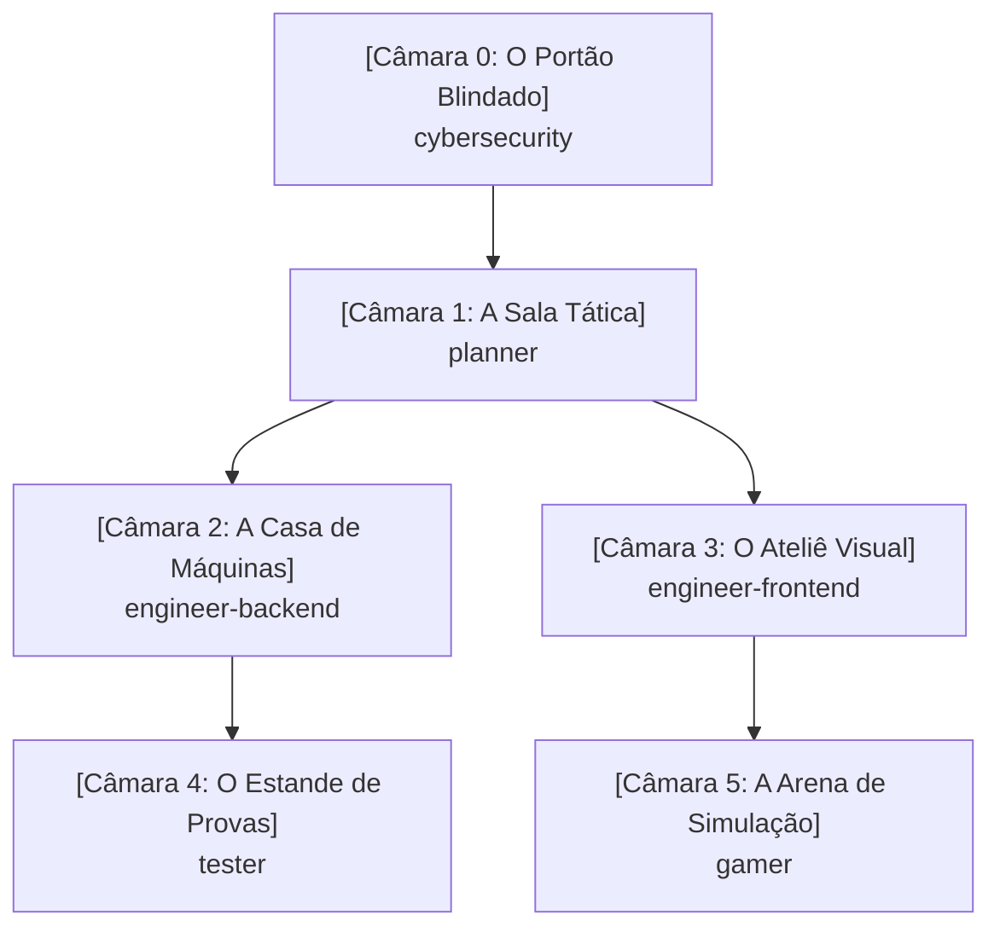

# Memory Palace do Workspace (Mapa Cognitivo)

Este documento atua como o **Palácio da Memória Compartilhado** do sistema. Todos os agentes e desenvolvedores consultam e atualizam este mapa para manter a coerência arquitetural, mecânicas, regras de segurança e decisões do projeto.

---

## 🏛️ Mapa Geral das Câmaras

---

## 🚪 Câmara 0: O Portão Blindado (`cybersecurity`)
- **Âncora Mnemônica:** Uma guarita de titânio com leitor biométrico, alarme anti-vazamento de segredos e scanner de infecções.
- **Responsabilidade:** Segurança preventiva (Secure by Design) e reativa.
- **Artefatos e Registros:**
  - *Cofre de Segredos:* Toda chave/credencial reside em `.env` ou gerenciador de segredos.
  - *Filtro de Desinfecção:* Validação rígida na entrada e sanitização na saída.
  - *Tábua dos 10 Mandamentos:* OWASP Top 10 permanentemente auditado.

---

## 🗺️ Câmara 1: A Sala Tática (`planner`)
- **Âncora Mnemônica:** Um mezanino envidraçado com mesas de guerra e telas holográficas. O Tech Lead usa luvas brancas cerimoniais (modo Read-Only: não escreve código funcional).
- **Responsabilidade:** Análise de trade-offs, roadmap, decomposição de tarefas e geração de prompts.
- **Artefatos e Registros:**
  - *Painel de Épicas:* Decomposição em etapas incrementais e planos de ação.
  - *Fábrica de Prompts:* Modelagem de instruções prontas para serem distribuídas aos engenheiros.

---

## ⚙️ Câmara 2: A Casa de Máquinas (`engineer-backend`)
- **Âncora Mnemônica:** O porão industrial com barulho de turbinas e módulos isolados que se comunicam por cabos blindados.
- **Responsabilidade:** APIs, lógica de negócios, modelagem de dados, arquitetura em camadas e performance.
- **Artefatos e Registros:**
  - *Gavetas Herméticas:* Clean Architecture / Hexagonal — regra de negócio não acopla a banco ou protocolo.
  - *Expedição Consolidada:* Prevenção a consultas N+1 com batching e caching.
  - *Caixa-Preta:* Logs e telemetria estruturados.

---

## 🎨 Câmara 3: O Ateliê Visual (`engineer-frontend`)
- **Âncora Mnemônica:** Um estúdio de design com monitores calibrados e piso geométrico em malha de 8px.
- **Responsabilidade:** Interfaces do usuário (UI), experiência (UX), acessibilidade (a11y) e responsividade.
- **Artefatos e Registros:**
  - *Mesa Pantográfica Mobile-First:* Telas concebidas para mobile e expandidas para desktop.
  - *Sensor de Acessibilidade:* Marcação HTML semântica, contraste e suporte a leitores de tela/teclado.
  - *Catálogo de Componentes:* Elementos atômicos e reutilizáveis.

---

## 🎯 Câmara 4: O Estande de Provas (`tester`)
- **Âncora Mnemônica:** Um estande de tiro com sensores automáticos de impacto e armadilhas para fantasmas de bugs passados.
- **Responsabilidade:** Qualidade contínua, testes unitários, testes de integração e testes de não-regressão.
- **Artefatos e Registros:**
  - *Bancada Tríplice AAA:* Todo teste segue `Arrange`, `Act`, `Assert`.
  - *Cela de Regressão:* Todo bug corrigido recebe um teste com o número da issue antes da resolução.

---

## 🕹️ Câmara 5: A Arena de Simulação (`gamer`)
- **Âncora Mnemônica:** Um fliperama de alta tecnologia com metrônomo calibrado em 60/120 FPS e cestas fechadas de reciclagem de objetos.
- **Responsabilidade:** Game loops, física 2D/3D, renderização Canvas/WebGL e eficiência extrema de CPU/GPU.
- **Artefatos e Registros:**
  - *O Metrônomo do Tempo:* `requestAnimationFrame` estrito com cálculo de `delta time`.
  - *Ciclo Fechado (Object Pool):* Reutilização de objetos de memória para evitar engasgos do Garbage Collector.

---

## 📜 Histórico de Decisões do Palácio (Log Mnemônico)
| Data | Câmara | Registro da Decisão / Mudança | Agente Responsável |
| :--- | :--- | :--- | :--- |
| 2026-10-17 | Todas | Instituição do Memory Palace como fonte de verdade | Todos |
| 2026-10-17 | engineer-backend | Modelagem SQL de cards, user_cards, decks, deck_cards e sincronizador YGOPRODeck com rate limit e blacklist | engineer-backend |
| 2026-10-17 | engineer-backend | Fluxo de Login -> Menu de Jogo (Solo vs Bot e Online Futuro) e controle de Posição de Batalha (Vertical ATK / Horizontal DEF) com rotação no tabuleiro | engineer-backend |
| 2026-10-17 | engineer-backend | Diversificação de cartas dos decks clássicos (máximo 3 cópias por carta, 15+ arquétipos únicos) e embaralhamento com algoritmo Fisher-Yates com alta entropia (crypto.getRandomValues e 3 passadas de riffle/wash) | engineer-backend |
| 2026-10-17 | tester | Criação da suíte de testes unitários (AAA / Vitest) cobrindo regras de sacrifício, cálculo de batalha e ataque direto | tester |
| 2026-10-17 | engineer-backend / planner | Verificação e validação do banco Supabase: schema aplicado com sucesso, bucket card-images criado e catálogo com 11.652 cartas sincronizadas | planner |
| 2026-10-17 | gamer | Implementação da sessão da partida (DuelMatchSession), Decks Clássicos e IA do Bot PvE (DuelBot) | gamer |
| 2026-10-17 | engineer-frontend | Construção da Mesa de Duelo (Playmat.tsx) com React/Tailwind, zonas espelhadas, cálculo de LP em tempo real e integração do Bot PvE | engineer-frontend |
| 2026-10-17 | engineer-frontend | Redesign visual da Mesa: Estilo Dark/Anime anos 2000 (Olho do Milênio, gradientes roxo/dourado), cartas ampliadas com arte integral nítida e painel lateral de inspeção | engineer-frontend |
| 2026-10-17 | gamer / tester / frontend | Resolução dos 6 itens: Início direto em MAIN1, escolha de Posição (ATK/DEF) com rotação 90°, mudança 1x/turno, contagem regressiva de 5s, botão de desistência, chat traduzido e 18 testes unitários passando | planner |

