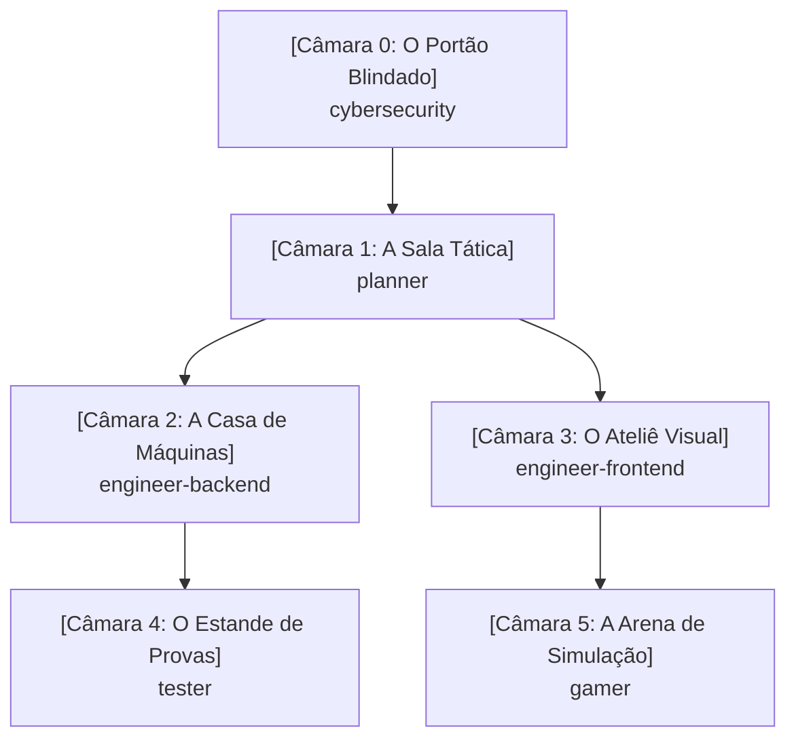

# Memory Palace do Workspace (Mapa Cognitivo)

Este documento atua como o **Palácio da Memória Compartilhado** do sistema. Todos os agentes e desenvolvedores consultam e atualizam este mapa para manter a coerência arquitetural, mecânicas, regras de segurança e decisões do projeto.

---

## 🏛️ Mapa Geral das Câmaras

---

## 🚪 Câmara 0: O Portão Blindado (`cybersecurity`)
- **Âncora Mnemônica:** Uma guarita de titânio com leitor biométrico, alarme anti-vazamento de segredos e scanner de infecções.
- **Responsabilidade:** Segurança preventiva (Secure by Design) e reativa.
- **Artefatos e Registros:**
  - *Cofre de Segredos:* Toda chave/credencial reside em `.env` ou gerenciador de segredos.
  - *Filtro de Desinfecção:* Validação rígida na entrada e sanitização na saída.
  - *Tábua dos 10 Mandamentos:* OWASP Top 10 permanentemente auditado.

---

## 🗺️ Câmara 1: A Sala Tática (`planner`)
- **Âncora Mnemônica:** Um mezanino envidraçado com mesas de guerra e telas holográficas. O Tech Lead usa luvas brancas cerimoniais (modo Read-Only: não escreve código funcional).
- **Responsabilidade:** Análise de trade-offs, roadmap, decomposição de tarefas e geração de prompts.
- **Artefatos e Registros:**
  - *Painel de Épicas:* Decomposição em etapas incrementais e planos de ação.
  - *Fábrica de Prompts:* Modelagem de instruções prontas para serem distribuídas aos engenheiros.

---

## ⚙️ Câmara 2: A Casa de Máquinas (`engineer-backend`)
- **Âncora Mnemônica:** O porão industrial com barulho de turbinas e módulos isolados que se comunicam por cabos blindados.
- **Responsabilidade:** APIs, lógica de negócios, modelagem de dados, arquitetura em camadas e performance.
- **Artefatos e Registros:**
  - *Gavetas Herméticas:* Clean Architecture / Hexagonal — regra de negócio não acopla a banco ou protocolo.
  - *Expedição Consolidada:* Prevenção a consultas N+1 com batching e caching.
  - *Caixa-Preta:* Logs e telemetria estruturados.

---

## 🎨 Câmara 3: O Ateliê Visual (`engineer-frontend`)
- **Âncora Mnemônica:** Um estúdio de design com monitores calibrados e piso geométrico em malha de 8px.
- **Responsabilidade:** Interfaces do usuário (UI), experiência (UX), acessibilidade (a11y) e responsividade.
- **Artefatos e Registros:**
  - *Mesa Pantográfica Mobile-First:* Telas concebidas para mobile e expandidas para desktop.
  - *Sensor de Acessibilidade:* Marcação HTML semântica, contraste e suporte a leitores de tela/teclado.
  - *Catálogo de Componentes:* Elementos atômicos e reutilizáveis.

---

## 🎯 Câmara 4: O Estande de Provas (`tester`)
- **Âncora Mnemônica:** Um estande de tiro com sensores automáticos de impacto e armadilhas para fantasmas de bugs passados.
- **Responsabilidade:** Qualidade contínua, testes unitários, testes de integração e testes de não-regressão.
- **Artefatos e Registros:**
  - *Bancada Tríplice AAA:* Todo teste segue `Arrange`, `Act`, `Assert`.
  - *Cela de Regressão:* Todo bug corrigido recebe um teste com o número da issue antes da resolução.

---

## 🕹️ Câmara 5: A Arena de Simulação (`gamer`)
- **Âncora Mnemônica:** Um fliperama de alta tecnologia com metrônomo calibrado em 60/120 FPS e cestas fechadas de reciclagem de objetos.
- **Responsabilidade:** Game loops, física 2D/3D, renderização Canvas/WebGL e eficiência extrema de CPU/GPU.
- **Artefatos e Registros:**
  - *O Metrônomo do Tempo:* `requestAnimationFrame` estrito com cálculo de `delta time`.
  - *Ciclo Fechado (Object Pool):* Reutilização de objetos de memória para evitar engasgos do Garbage Collector.

---

## 📜 Histórico de Decisões do Palácio (Log Mnemônico)
| Data | Câmara | Registro da Decisão / Mudança | Agente Responsável |
| :--- | :--- | :--- | :--- |
| 2026-10-17 | Todas | Instituição do Memory Palace como fonte de verdade | Todos |
| 2026-10-17 | engineer-backend | Modelagem SQL de cards, user_cards, decks, deck_cards e sincronizador YGOPRODeck com rate limit e blacklist | engineer-backend |
| 2026-10-17 | engineer-backend | Fluxo de Login -> Menu de Jogo (Solo vs Bot e Online Futuro) e controle de Posição de Batalha (Vertical ATK / Horizontal DEF) com rotação no tabuleiro | engineer-backend |
| 2026-10-17 | engineer-backend | Diversificação de cartas dos decks clássicos (máximo 3 cópias por carta, 15+ arquétipos únicos) e embaralhamento com algoritmo Fisher-Yates com alta entropia (crypto.getRandomValues e 3 passadas de riffle/wash) | engineer-backend |
| 2026-10-17 | engineer-backend | Implementação do sistema de Invocação-Tributo (Sacrifício): 1 monstro para nível 5-6 e 2 monstros para nível 7+, com seleção interativa de monstros no campo, liberação de zonas, envio ao cemitério e testes unitários AAA | engineer-backend |
| 2026-10-17 | engineer-backend | Regra de invocação e ataque: monstro invocado no turno atual não pode declarar ataque (só ataca a partir do próximo turno), com bloqueio no motor de regras, IA do Bot, badge visual 'Invocado ⏳' e testes unitários de regressão | engineer-backend |
| 2026-10-17 | engineer-backend | Simplificação da invocação: monstros entram diretamente em Posição de Ataque (sem popup de pergunta) e o jogador pode clicar no monstro no seu campo para alternar livremente (ATK <-> DEF) durante a Fase Principal. Ao entrar na Fase de Batalha ou passar o turno, a posição fica travada e prevalece até o próximo turno do jogador | engineer-backend |
| 2026-10-17 | engineer-backend | Implementação de filtro e marcação da era Reino dos Duelistas no Supabase (colunas is_duelist_kingdom e era com índices), mapeamento dos sets oficiais (LOB, MRD, MRL/SRL, PSV, SDY, SDK, SDJ, SDP) com blacklist, script tag_duelist_kingdom.py e CardCatalogService em TypeScript | engineer-backend |
| 2026-10-17 | engineer-backend | Execução da marcação da era Reino dos Duelistas no Supabase: 493 cartas clássicas oficiais marcadas com is_duelist_kingdom = true e era = 'DUELIST_KINGDOM' com 0 vazamentos de Fusões, Exodia ou Deuses Egípcios | engineer-backend |
| 2026-10-17 | engineer-backend | Adição das colunas effect_type (TEXT) e effect_definition (JSONB) com índices na tabela public.cards, população dos 5 primeiros efeitos clássicos (Buster Blader, Man-Eater Bug, Penguin Soldier, Kuriboh, Time Wizard) e tipagem rigorosa em duel-types.ts e starter-decks.ts | engineer-backend |
| 2026-10-17 | engineer-backend | Validação e auditoria no Supabase: migração aplicada com sucesso, colunas ativas e 5/5 efeitos JSONB validados via API PostgREST | engineer-backend |
| 2026-10-17 | tester | Criação da suíte de testes unitários (AAA / Vitest) cobrindo regras de sacrifício, cálculo de batalha e ataque direto | tester |
| 2026-10-17 | engineer-backend / planner | Verificação e validação do banco Supabase: schema aplicado com sucesso, bucket card-images criado e catálogo com 11.652 cartas sincronizadas | planner |
| 2026-10-17 | gamer | Implementação da sessão da partida (DuelMatchSession), Decks Clássicos e IA do Bot PvE (DuelBot) | gamer |
| 2026-10-17 | engineer-frontend | Construção da Mesa de Duelo (Playmat.tsx) com React/Tailwind, zonas espelhadas, cálculo de LP em tempo real e integração do Bot PvE | engineer-frontend |
| 2026-10-17 | engineer-frontend | Redesign visual da Mesa: Estilo Dark/Anime anos 2000 (Olho do Milênio, gradientes roxo/dourado), cartas ampliadas com arte integral nítida e painel lateral de inspeção | engineer-frontend |
| 2026-10-17 | gamer / tester / frontend | Resolução dos 6 itens: Início direto em MAIN1, escolha de Posição (ATK/DEF) com rotação 90°, mudança 1x/turno, contagem regressiva de 5s, botão de desistência, chat traduzido e 18 testes unitários passando | planner |
| 2026-10-17 | engineer-backend | Implementação de ATK dinâmico contínuo (Buster Blader +500 por Dragão no campo/cemitério adversário) e resolução de efeitos FLIP (Man-Eater Bug destrói atacante, Penguin Soldier devolve atacante à mão), atualização da IA do Bot (DuelBot) e 30 testes unitários AAA passando | engineer-backend |
| 2026-10-17 | engineer-backend | Implementação dos efeitos de Kuriboh (HAND_TRIGGER: canActivateKuriboh, activateKuriboh descartando da mão para o cemitério e anulando dano) e Time Wizard (IGNITION: activateTimeWizard com roleta 50/50 em crypto.getRandomValues, HEADS destrói campo oponente, TAILS destrói campo do usuário e aplica burn damage da metade do ATK total, flag hasUsedEffectThisTurn resetada no endTurn) e 33 testes unitários AAA passando | engineer-backend |
| 2026-10-17 | engineer-backend | Adição e padronização das traduções oficiais consagradas em Português (Brasil) para os campos namePt e descriptionPt em todas as 29 cartas clássicas de starter-decks.ts (Yugi e Kaiba), mantendo 33/33 testes passando | engineer-backend |
| 2026-10-17 | engineer-backend | Implementação da mecânica Face-Down (virado para baixo) com turnSet, trava de flip manual no mesmo turno, disparo de efeito FLIP ao virar manualmente, resolução prioritária de efeitos FLIP antes do combate (interrupção do ataque e preservação do monstro defensor caso o atacante seja destruído ou devolvido à mão), atualização da IA DuelBot para baixar cartas FLIP ocultas em DEFENSE e 36 testes unitários AAA passando | engineer-backend |
| 2026-10-17 | engineer-backend | Ajuste da assinatura de changeMonsterPosition para retornar PositionChangeResult ({ success, flipped, flipEffect: { cardName, action, targetCardUid, targetName } }), acionamento reativo do banner de efeito visual no Playmat e 38 testes unitários AAA passando | engineer-backend |
| 2026-10-17 | engineer-backend | Implementação de retorno inteligente no efeito FLIP do Soldado Pinguim: devolução automática de todos os alvos se <= 2 monstros no campo do oponente, suporte a selectedTargetUids (alvos específicos do jogador) se > 2 monstros, e seleção inteligente automática dos 2 monstros com maior ATK efetivo para a IA/Bot, com 41 testes unitários AAA passando | engineer-backend |
| 2026-10-17 | engineer-backend | Desacoplamento dos efeitos de cartas de duel-match-session.ts para Action Handlers modulares (src/duel/effects/action-handlers.ts): BOOST_ATK, DESTROY_MONSTER, RETURN_TO_HAND, PREVENT_DAMAGE, COIN_TOSS_CLEAR acionados via effectDefinition declarativa, eliminando verificações rígidas por ID de carta e garantindo 100% de aprovação (47/47 testes passando) | engineer-backend |
| 2026-10-18 | gamer | Implementação da trilha sonora dinâmica por camadas verticais (Vertical Layering) em TypeScript com Howler.js no client/src/utils/AdaptiveSoundtrackManager.ts (stems: baseRhythm, orchestralMelody, epicChoir), Web Audio API estrito (html5: false), transição suave com crossfade de 2000ms, idempotência de estados e suíte de testes unitários desacoplada com 60/60 testes aprovados | gamer |
| 2026-10-18 | gamer | Síntese e geração dos 3 stems de áudio em loop em D Egyptian Frígio/Harmônico a 120 BPM com 8.00s exatos (stem_base_rhythm, stem_orchestral_melody, stem_epic_choir em MP3 e WebM Opus) em client/public/audio/soundtrack/, validados na suíte Vitest com 61/61 testes passando | gamer |
| 2026-10-18 | gamer | Substituição das trilhas sintéticas pelas trilhas sonoras consagradas de Yu-Gi-Oh! Forbidden Memories (Menu Principal, Partidas [Egypt in Ruins / Password], Fanfarra de Vitória [You Win] e Tema de Derrota [You Lose]) em MP3 de alta definição em client/public/audio/, integradas via SoundtrackManager com suíte de testes Vitest aprovada (60/60) | gamer |
| 2026-10-18 | engineer-backend | Integração de Magias e Armadilhas clássicas (Pot of Greed, Dark Hole, Fissure, Trap Hole) aos Starter Decks balanceados com 40 cartas (34 monstros + 6 magias/armadilhas) e implementação dos métodos canActivateTrapHole e activateTrapHole em DuelMatchSession, com 68/68 testes automatizados passando | engineer-backend |

| 2026-10-18 | gamer | Ajuste de sincronização da exibição de fim de partida no Playmat.tsx: correção do identificador de vencedor (match.winnerPlayerId), disparo imediato das faixas de Vitória (You Win) e Derrota (You Lose) em sincronia com o modal temático comemorativo/fúnebre e 60/60 testes passando | gamer |
| 2026-10-18 | engineer-frontend | Padronização e calibração responsiva do Playmat: zonas de monstros e magias com dimensões fixas permanentes (vazio vs ocupado), resolução do clipping horizontal de cartas em DEF via .card-defense-wrapper e .card-defense-img (overflow-visible), enquadramento estrito em 100vh com eliminação de corte no rodapé (mão/deck/cemitério) e ErrorBoundary em App.tsx | engineer-frontend |
| 2026-10-18 | engineer-backend | Refinamento das regras oficiais: triggersFlip estritamente condicionado a wasFaceDown && FLIP em declareAttack (monstros revelados de face para cima em defesa não ativam efeito ao serem atacados) e trava de ativação de Cartas Mágicas baixadas no campo no mesmo turno (turnSet < currentTurn em activateSpell), com 72/72 testes passando | engineer-backend |
| 2026-10-18 | gamer | Implementação de fila sequencial de reprodução durante a partida no SoundtrackManager (alternância fluida e contínua via onend entre Egypt in Ruins e Password sem sobreposição de áudio), preservação estrita da música do Menu Principal, garantia de parada de todas as outras faixas ao disparar Vitória (You Win) ou Derrota (You Lose) e 73/73 testes passando | gamer |
| 2026-10-18 | gamer | Blindagem do loop de ataque do bot no Playmat.tsx (animação e banner FLIP estritamente condicionados a wasFaceDown) e ativação de Cartas Mágicas baixadas viradas para baixo no campo em turnos anteriores (turnSet < currentTurn) via modal de confirmação no Playmat, com 73/73 testes passando | gamer |

